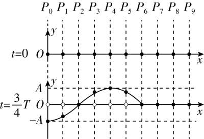

# Physics - 题目 756

**ID**: 43ff3e306e324870b1d146e498ffa69e
**年级**: Grade 11
**难度**: Medium-Hard
**题型**: 单选题：本部分共14题，每题3分，共42分。在每题列出的四个选项中，选出最符合题目要求的一项。

## 题目
在如图所示的xOy坐标系中，一条弹性绳沿x轴放置，图中小黑点代表绳上的质点，相邻质点的间距为a。​​​​​​​‌t＝0时，x＝0处的质点P_{0}开始沿y轴做周期为T、振幅为A的简谐运动。 ${\rm \mathit{t}＝}\frac{3}{4}{\rm \mathit{T}}$ 时的波形如图所示。下列说法正确的是（      ）

## 解答

1. 

## 知识点

**中文**:
  - 波的图像及其应用
  - 波长、频率和波速的关系及应用

**English**:
  - Wave Graphs and Applications
  - Relationship between Wavelength, Frequency, Wave Speed

---
