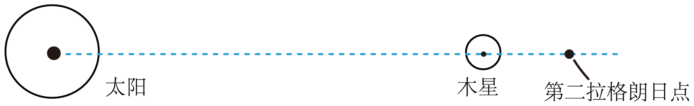

# Physics - 题目 1920

**ID**: 3c34e6b3e634461f923b30bdfc760f36
**年级**: Grade 11
**难度**: Medium-Hard
**题型**: 掩体计划的技术问题。

## 题目
该计划所涉及的技术基本在人类已达到的范围之内，舰队国际已具有丰富的太空城建设经验，并且已经在木星拥有相当规模的太空基地。​​​​​​​‌也存在一些预计能够在计划规划的时间内克服的技术挑战，如太空城的位置维持。太空城不是四大行星的卫星，它们在行星的背阳面与行星保持相对静止的状态，且与行星的距离很近，引力会将太空城拉向行星，所以必须在太空城上安装位置维持发动机，以抵消行星引力，保持太空城与行星间的距离。最初计划太空城的位置位于巨行星的第二拉格朗日点，这是位于巨行星外侧的引力平衡点，没有位置维持问题，但发现距离掩体行星太远，难以起到防护作用。……“我们进去吧。”褚岩说，然后像跳水似的钻进了那个空间。莫沃维奇和关一帆惊恐地看着他的身体从头到脚消失在空气中，在空间泡无形球面上，他身体的断面飞快地变换着形状，那晶亮的镜面甚至在周围的舱壁上反射出水纹一样跳动的光影。褚岩很快完全消失了，正当莫沃维奇和关一帆面面相觑之际，突然从那个空间伸出两只手，那两只手和前臂都悬在空中，分别伸向两人，莫沃维奇和关一帆各抓住一只手，立刻都被拉进了四维空间。有过亲身经历的人都一致同意，置身四维空间的感觉是不可能用语言来描述的，他们甚至断言，四维感觉是人类迄今为止所遇到的唯一一种绝对不可能用语言描述的事物。人们总是喜欢用这样一个类比：想象生活在三维空间中的一张二维平面画中的扁片人，不管这幅画多么丰富多彩，其中的二维人只能看到周围世界的侧面，在他们眼中，周围的人和事物都是一些长短不一的线段而已。只有当一个二维扁片人从画中飘出来，进人三维空间，再回头看那幅画，才能看到画的全貌。这个类比，其实也只是进一步描述了四维感觉的不可描述。首次从四维空间看三维世界的人，首先领悟到一点：以前身处三维世界时，他其实根本没看见过自己的世界，如果把三维世界也比做一张画，他看到的只是那张画与他的脸平面垂宣放置时的样子，看到的只是画的侧面，一条线；只有从四维看，画才对他平放了。他会这样描述：任何东西都不可能挡住它后面的东西，任何封闭体的内部也都是能看到的。这只是一个简单的规则，但如果世界真按这个规则呈现，在视觉上是极其震撼的。当所有的遮挡和封闭都不存在，一切都暴露在外时，目击者首先面对的是相当于三维世界中亿万倍的信息量，对于涌进视觉的海量信息，大脑一时无法把握。（取材于刘慈欣《三体全集：地球往事三部曲》）太阳系基本数据太阳水星金星地球火星木星土星天王星海王星质量（kg）$2\times 10{^{30}}$$3\times 10{^{23}}$$5\times 10{^{24}}$$6\times 10{^{24}}$$6\times 10{^{23}}$$2\times 10{^{27}}$$6\times 10{^{26}}$$9\times 10{^{25}}$$1\times 10{^{26}}$平均轨道半径（A。U。）-0.40.711.55.29.519.130$1{\rm{A}}{{.}}{\rm{U}}{{.}}=1.5\times 10{^{11}}{\rm{m}}$(1)拉格朗日点是指太阳与行星构成的系统中的某个点，在该点放置一个质量很小的物体，该物体仅在太阳和行星（如木星）的万有引力作用下，可以保持与太阳和行星的相对位置不变，即能保持相对静止。系统中存在有多个拉格朗日点，其中一个位于行星的外侧，称为第二拉格朗日点，如下图所示：i.对于“太阳-木星”系统，下列说法正确的是：

## 解答

1. （1）i. [1]AC．根据题意可知第二拉格朗日点位置的物体的角速度与木星的角速度相等，根据太阳和木星万有引力的合力提供向心力可知，若要计算第二拉格朗日点与太阳间的距离，需要木星的质量，A正确，C错误；
2. B．若物体位于第二拉格朗日点，太阳和木星万有引力的合力提供向心力，物体处于完全失重的状态，B错误；
3. D．根据材料太空城不是四大行星的卫星，它们在行星的背阳面与行星保持相对静止的状态，且与行星的距离很近，引力会将太空城拉向行星，所以必须在太空城上安装位置维持发动机，以抵消行星引力，可知太空城不是位于木星的第二拉格朗日点处，D错误。选A。
4. ii. [2]要满足是拉格朗日点，需要角速度在该点运行的物体角速度与月球角速度相等：
5. AD．在 $AD$ 两点，地球和月球的万有引力的合力提供向心力，月球由地球的万有引力提供向心力，质量约掉后，所以该点的向心加速度大于月球的向心加速度，同时该点的轨道半径大，可能是拉格朗日点，AD错误；
6. B．在 $B$ 点，地球和月球的万有引力的合力提供向心力，月球由地球的万有引力提供向心力，质量约掉后，所以该点的向心加速度大于月球的向心加速度，同时该点的轨道半径小，根据 $a{{}_{{\rm{n}}}}=ω{^{2}}r$ 可知该点的角速度一定大于月球的角速度，不可能是拉格朗日点，B正确；
7. C．在 $C$ 点，地球和月球的万有引力的合力提供向心力，月球由地球的万有引力提供向心力，质量约掉后，所以该点的向心加速度小于月球的向心加速度，同时该点的轨道半径小，可能是拉格朗日点，C错误。选B。
8. （2）i.根据质能方程 $E=Δmc{^{2}}$ ，代入数据可得 $E\approx 2\times 10{^{47}}{\rm{J}}$
9. ii. 太阳爆发出能量 $E{{}_{0}}$ 的破坏，即对星球的破坏作用，应正比于星球表面各点所接收到的能量。也就是说，太阳爆发的破坏，正比于行星所在位置的能量（面）密度 $E^{′}{\propto }\frac {E{{}_{0}}}{S}=\frac {E{{}_{0}}}{4πr{^{2}}}$ ，与距离的平方成反比。
10. iii.根据题目所给数据以及（2）ii问中结论，在三维空间，木星处受到的破坏了是地球处的 $\frac {1}{27}$ ，即 $\frac {E^{′}{{{}_{木}}}}{E^{′}{{{}_{地}}}}=\frac {r{{}_{地}^{2}}}{r{{}_{木}^{2}}}=（\frac {1}{5.2}）{^{2}}=\frac {1}{27}$ ，而在四维空间内，体积与距离的四次方成正比，显然表面积与距离的三次方成正比。由能量守恒知 $E^{′′}{\propto }\frac {E{{}_{0}}}{S^{′}}\propto \frac {E{{}_{0}}}{r{^{3}}}=\frac {E^{′}{{{}_{地}}}}{r{{}_{地}}}=\frac {E^{′}{{{}_{地}}}}{6\times 10{^{24}}}<<\frac {E^{′}{{{}_{地}}}}{27}=E^{′}{{{}_{木}}}$ ，所以在四维空间是安全的。

## 知识点

**中文**:
  - 开普勒三大定律及其应用

**English**:
  - Kepler's Three Laws and Applications

---
