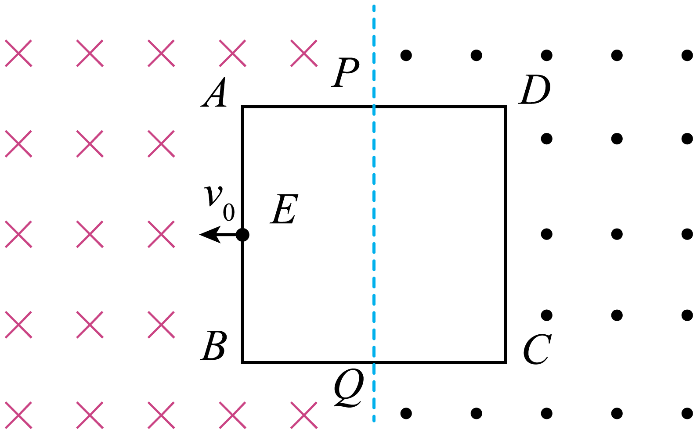

# Physics - 题目 606

**ID**: 055213a2f95343ee96560926b4ad6202
**年级**: Grade 11
**难度**: Medium
**题型**: Multiple-choice

## 题目
如图所示，边长为 $a=0.4{\rm{m}}$ 正方形区域ABCD内无磁场，正方形中线PQ将区域外左右两侧分成两个磁感应强度均为 $B=0.2{\rm{T}}$ 的匀强磁场区域，PQ右侧磁场方向垂直于纸面向外，PQ左侧磁场方向垂直于纸面向里。​​​​​​​‌现将一质量为 $m=1\times 10{^{-8}}{\rm{k}}{\rm{g}}$ ，电荷量为 $q=2\times 10{^{-6}}{\rm{C}}$ 的正粒子从AB中点以某一速率垂直于AB射入磁场，不计粒子的重力，则关于粒子的运动，下列说法正确的是（      ）

## 解答

1. 根据题意可知，粒子在磁场中做匀速圆周运动由洛伦兹力提供向心力有 $qvB=m\frac {v{^{2}}}{r}$ ，解得 $v=\frac {qBr}{m}$ ，若粒子能垂直于 $BC$ 射入正方形区域内，则粒子可能的运动轨迹如图所示：
2. 
3. 由几何关系可得 $(2n+1)r=\frac {a}{2}(n=0,1,2,\cdot \cdot \cdot )$ ，解得 $v=\frac {qBa}{(4n+2)m}(n=0,1,2,\cdot \cdot \cdot )$ ，当 $n=0$ 时，速度最大为 $v{{}_{{\rm \max }}}=8{\rm{m}}{\rm{/}}{\rm{s}}$ ，当 $n=1$ 时 $v=\frac {8}{3}{\rm{m}}{\rm{/}}{\rm{s}}$ ，当 $n\mathrm{=}2$ 时 $v=\frac {8}{5}{\rm{m}}{\rm{/}}{\rm{s}}$ ，当 $n=3$ 时 $v=\frac {8}{7}{\rm{m}}{\rm{/}}{\rm{s}}$ ，选D。

## 知识点

**中文**:
  - 带电粒子在有界磁场中运动的临界极值问题

**English**:
  - Critical Extremum Problems in Bounded Magnetic Fields

---
