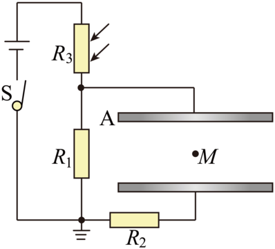

# Physics - 题目 1884

**ID**: 1808ca2c0e6046bbb423c273986f4e8c
**年级**: Grade 11
**难度**: Medium
**题型**: Multiple-choice

## 题目
如图所示，直流电路中， $R{{}_{1}}$ 、 $R{{}_{2}}$ 是定值电阻， $R{{}_{3}}$ 是光敏电阻，其阻值随光照增强而减小，当开关S闭合时，处在电容器两板间M点的带电液滴恰好能保持静止．现用强光照射电阻 $R{{}_{3}}$ ，则（      ）​​​​​​​‌

## 解答

1. A．电路稳定时电容器两板间的电压等于 $R{{}_{1}}$ 两端的电压，当用强光照射光敏电阻 $R{{}_{3}}$ 时，光敏电阻的阻值变小，电路中电流增大，根据 $P=EI$ ，可知电源的总功率增大，A错误；
2. B．由于电路中的电流增大， $R{{}_{1}}$ 两端的电势差增大，又因为 $R{{}_{1}}$ 下端接地，电势为零，所以 $R{{}_{1}}$ 上端电势升高， $\mathrm{A}$ 板的电势也升高，B错误；
3. C．由以上分析可知，电容器两板间场强方向向下，对液滴，由平衡条件分析可知液滴带负电，当用强光照射光敏电阻 $R{{}_{3}}$ 时， $R{{}_{1}}$ 两端的电压增大，电容器两板间的电压等于 $R{{}_{1}}$ 两端的电压，也增大，所以板间场强增大，液滴所受的电场力增大，则液滴向上运动，C正确；
4. D．电容器两板间的电压增大，电容不变，由 $Q=CU$ ，可知电容器所带电荷量增加，D错误。选C。

## 知识点

**中文**:
  - 平行板电容器电容大小及其影响因素
  - 电路的动态分析问题

**English**:
  - Factors Affecting Capacitance of Parallel Plate Capacitors
  - Dynamic Circuit Analysis

---
