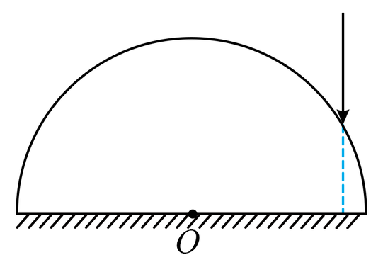

# Physics - 题目 201

**ID**: 185aa99dbe8c4d0a9ba65e3958b75baf
**年级**: Grade 11
**难度**: Medium
**题型**: Multiple-choice

## 题目
如图所示，半径为R的半球形玻璃砖的折射率为 $\sqrt {3}$ ，底面镀银（光线发生反射），球心为O，与底面垂直的一束光线从圆弧面射入，已知该光线与O点之间的距离为 $\frac {\sqrt {3}}{2}R$ ，光在真空中传播速度为c，此光线在玻璃砖内传播的时间为（      ）​​​​​​​‌

## 解答

1. 折射率 $n=\frac {\sin θ{{}_{入}}}{\sin θ{{}_{折}}}$ ，由几何关系可知 $θ{{}_{入}}=60{}\degree $ ，解得 $θ{{}_{折}}=30{}\degree $ ，解得折射率 $n=\sqrt {3}$ ，由光路图可知，光线传播路程为 $s=\frac {\sqrt {3}R}{3}+\frac {2\sqrt {3}}{3}R=\sqrt {3}R$ ，光线在玻璃砖内传播的速度 $v=\frac {c}{n}=\frac {\sqrt {3}}{3}c$ ，时间 $t=\frac {s}{v}=\frac {3R}{c}$ 。
2. 
3. 故B正确。

## 知识点

**中文**:
  - 全反射与折射的综合应用

**English**:
  - Comprehensive Application of Total Reflection and Refraction

---
