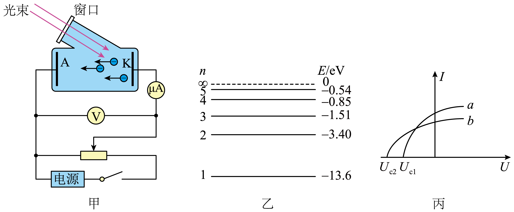

# Physics - 题目 915

**ID**: 25f58e1692494ced8b0a0cb2baee1728
**年级**: Grade 11
**难度**: Medium
**题型**: Multiple-choice

## 题目
某光线发射器辐射出的光子是由大量处于 $n=3$ 激发态的氢原子向低能级跃迁时产生的，用它发出的光照射图甲中的光电管，只有 $a$ 、 $b$ 两种不同频率的光可以使阴极逸出光电子，图乙为氢原子能级图，图丙为 $a$ 、 $b$ 光单独照射光电管时产生的光电流 $I$ 与光电管两端电压 $U$ 的关系图线。​​​​​​​‌已知光电管阴极材料的逸出功为 $2.25{\rm{e}}{\rm{V}}$ ，下列说法正确的是（      ）

## 解答

1. 大量处于 $n=3$ 激发态的氢原子向低能级跃迁时，最多能辐射出不同频率光的种类数为 $\frac {3\times \left ({3-1}\right )}{2}=3$ ，故A错误；根据图丙可知， $a$ 光的遏止电压小于 $b$ 光的遏止电压，根据 $eU{{}_{{\rm{c}}}}=E{{}_{{\rm{k}}{\rm \max }}}=hν-W{{}_{0}}$ ，可知， $a$ 光的频率低于 $b$ 光的频率，故B错误；根据图乙可知，大量处于 $n=3$ 激发态的氢原子向低能级跃迁时，辐射出的三种光子的能量分别为 $-1.51{\rm{e}}{\rm{V}}-\left ({-13.6}\right ){\rm{e}}{\rm{V}}=12.09{\rm{e}}{\rm{V}}$ ， $-3.4{\rm{e}}{\rm{V}}-\left ({-13.6}\right ){\rm{e}}{\rm{V}}=10.2{\rm{e}}{\rm{V}}$ ， $-1.51{\rm{e}}{\rm{V}}-\left ({-3.4}\right ){\rm{e}}{\rm{V}}=1.89{\rm{e}}{\rm{V}}$
2. 由于 $a$ 光的频率低于 $b$ 光的频率，且 $a$ 、 $b$ 光单独照射光电管均能够发射光电效应，可知， $a$ 光的光子能量低于 $b$ 光的光子能量，且两光的光子能量均大于 $2.25{\rm{e}}{\rm{V}}$ ，即 $b$ 光的光子能量为 $12.09{\rm{e}}{\rm{V}}$ ，则用 $b$ 光照射时，飞出阴极光电子的初动能为 $E{{}_{{\rm{k}}{\rm \max }}}=hν-W{{}_{0}}=12.09{\rm{e}}{\rm{V}}-2.25{\rm{e}}{\rm{V}}=9.84{\rm{e}}{\rm{V}}$ ，故C正确；测量遏止电压时，电子逸出后将做减速运动，电子带负电，所受电场力方向向右，则电场强度方向向左，可知，要测出丙图中的 $U{{}_{{\rm{c}}1}}$ 和 $U{{}_{{\rm{c}}2}}$ ，甲图中电源的左端应为其负极，故D错误。

## 知识点

**中文**:
  - 光电效应方程的图像问题
  - 光电流、遏止电压相关问题
  - 原子跃迁过程中原子总能量、电势能和电子动能的变化规律

**English**:
  - Graph Problems of Photoelectric Equation
  - Photocurrent and Stopping Potential Problems
  - Energy Changes during Atomic Transitions

---
