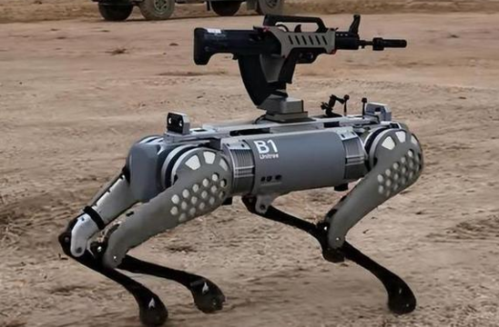

# Physics - 题目 2200

**ID**: 2b983e8580cb4d859cde340cb84d4868
**年级**: Grade 11
**难度**: Medium
**题型**: Multiple-choice

## 题目
如图是我国自主研发的机器狗，在水平地面上站定不动2s内水平发射了6颗子弹，每颗子弹的质量m=30g，子弹出膛时对地速度v_{0}=800m/s，机器狗及其装备的总质量M=40kg，重力加速度g=10m/s^{2}，机器狗发射子弹的过程，下列说法正确的是（      ）​​​​​​​‌

## 解答

1. 由于地面对系统施加的摩擦力产生外冲量，故系统总动量不守恒，故A错误；机器狗及其枪口均无水平方向位移，地面对系统的摩擦力也无水平方向的位移，故地面对机器狗、枪和子弹组成的系统不做功，故B错误；每颗子弹的质量为m= 0.03 kg，出膛速度为v_{0}=800 m/s，则每颗子弹的动量mv_{0}=24kg·m/s，6颗子弹总动量为6×24kg·m/s=144kg·m/s，故 $I{{}_{狗对子弹}}=144{\rm{N}}\cdot {\rm{s}}$ 。机器狗在发射子弹前后整体保持静止，其自身动量不变，所以对机器狗而言 $I{{}_{子弹对狗}}+I{{}_{f}}=0$ ，所以地面摩擦力提供的总冲量大小为I_{f}=144N·s，则机器狗对地面摩擦力的冲量大小也为144N·s，故C正确；地面对机器狗的作用力有支持力和摩擦力，地面摩擦力提供的总冲量大小为I_{f}=144N·s，支持力冲量大小为 $Mgt=800{\rm{N}}\cdot {\rm{s}}$ 。地面对机器狗的冲量大小为 $\sqrt {{\left({I{{}_{f}}}\right)^{2}}+{\left({Mgt}\right)^{2}}}>800{\rm{N}}\cdot {\rm{s}}$ ，故D错误。

## 知识点

**中文**:
  - 动量守恒的判定与应用
  - 动量定理及其应用

**English**:
  - Judgment and Application of Momentum Conservation
  - Applications of Impulse-Momentum Theorem

---
