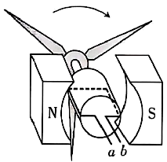

# Physics - 题目 2600

**ID**: 364fb9f0e76f4a9eb8caaa08bb94d806
**年级**: Grade 11
**难度**: Medium
**题型**: Multiple-choice

## 题目
如图为某高空风车发电机示意图，图示位置线圈平面与磁感线平行，则此时，下列说法正确的是（      ）​​​​​​​‌

## 解答

1. 图示位置线圈平面与磁感线平行，则穿过线圈的磁通量为0，即线圈中磁通量最小，A错误；图示位置线圈平面与磁感线平行，线圈左右两边转动的线速度方向与磁场方向垂直，根据 $E=E{{}_{左}}+E{{}_{右}}=2NBLv$ ，可知，此时线圈产生的感应电动势达到最大值，即线圈中磁通量变化率最大，B错误；根据右手定则可知，感应电流从a端进入，b端出来，线圈为一个等效电源，则a端为等效电源的负极，b端为等效电源的正极，可知，a端电势比b端电势低，C正确；线圈每经过中性面一次，感应电流方向改变一次，此位置与中性面垂直，感应电流方向没有发生变化，D错误。

## 知识点

**中文**:
  - 导体切割磁感线产生感应电动势（电流）的分析与计算

**English**:
  - Analysis and Calculation of Cutting Magnetic Field Lines

---
