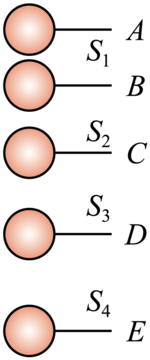

# Physics - 题目 1117

**ID**: 3ad52e6a5a4441d68020c73acaf8a5c5
**年级**: Grade 11
**难度**: Medium
**题型**: Multiple-choice

## 题目
暗室中小球做自由落体，按下胶片照相机的快门并使之处于常开状态，频闪仪每隔时间T发出一次强烈闪光，得频闪照片如图所示，测量并按照比例尺换算得相邻位置距离，重力加速度为g，则小球在图中D位置瞬时速度为（      ）​​​​​​​‌

## 解答

1. 根据匀变速直线运动速度与时间的关系可知， $v{{}_{D}}=v{{}_{A}}+g\cdot 3T=v{{}_{A}}+3gT$ ，根据匀变速直线运动速度与位移的关系可知， $v{{}_{D}^{2}}-v{{}_{A}^{2}}=2g\left ({s{{}_{1}}+s{{}_{2}}+s{{}_{3}}}\right )$ ，解得 $v{{}_{D}}=\sqrt {v{{}_{A}^{2}}+2g(s{{}_{1}}+s{{}_{2}}+s{{}_{3}}）}$ ，因A位置不一定是自由落体运动的起始位置， $v{{}_{A}}$ 不一定为零，ACD错误；根据匀变速直线运动某段时间内的平均速度等于中间时刻的速度可知， $v{{}_{D}}=\frac {s{{}_{3}}+s{{}_{4}}}{2T}{\rm ，B}$ 正确。

## 知识点

**中文**:
  - 匀变速直线运动基本公式的灵活应用
  - 自由落体运动规律的应用

**English**:
  - Flexible Application of Basic UVRM Formulas
  - Applications of Free Fall Laws

---
