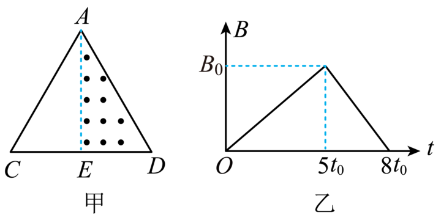

# Physics - 题目 1213

**ID**: 44a2688a797f44b2bb21fc25c8cedbae
**年级**: Grade 11
**难度**: Medium
**题型**: Multiple-choice

## 题目
如图甲所示，等边三角形金属框ACD的边长均为L，单位长度的电阻为r，E为CD边的中点，三角形ADE所在区域内有磁感应强度垂直纸面向外、大小随时间变化的匀强磁场，图乙是匀强磁场的磁感应强度B随时间t变化的图像。​​​​​​​‌下列说法正确的是（      ）

## 解答

1. 由图乙可知，t_{0}时刻磁感应强度大小为 $B=\frac {B{{}_{0}}}{5t{{}_{0}}}\cdot t{{}_{0}}=\frac {B{{}_{0}}}{5}$ ，此时穿过金属框的磁通量为 $Φ=BS=\frac {B{{}_{0}}}{5}\cdot \frac {1}{2}\cdot \frac {L}{2}\cdot \frac {\sqrt {3}L}{2}=\frac {\sqrt {3}B{{}_{0}}L{^{2}}}{40}{\rm ，A}$ 错误；金属框中的感应电动势大小为 $E=\left |{\frac {{\rm{Δ}}{\rm{Φ}}}{{\rm{Δ}}t}}\right |=S\left |{\frac {{\rm{Δ}}B}{{\rm{Δ}}t}}\right |=S\left |{k}\right |$ ，由图可知 $0\sim 5t{{}_{0}}$ 时间内B-t图线的斜率绝对值比 $5t{{}_{0}}\sim 8t{{}_{0}}$ 时间内斜率的绝对值小，所以 $0\sim 5t{{}_{0}}$ 时间内的感应电动势小于 $5t{{}_{0}}\sim 8t{{}_{0}}$ 时间内的感应电动势，且 $5t{{}_{0}}$ 时刻，金属框内的感应电流由小变大，BC错误； $5t{{}_{0}}\sim 8t{{}_{0}}$ 时间内，金属框中的感应电动势大小为 $E=S\left |{\frac {{\rm{Δ}}B}{{\rm{Δ}}t}}\right |=\frac {\sqrt {3}L{^{2}}B{{}_{0}}}{24t{{}_{0}}}$ ，由题意可知ADE段和ACD段金属框的电阻相等，则A、E两点的电势差的绝对值恒为 $\left |{U{{}_{AE}}}\right |=\frac {1}{2}E=\frac {\sqrt {3}B{{}_{0}}L{^{2}}}{48t{{}_{0}}}{\rm ，D}$ 正确。

## 知识点

**中文**:
  - 电磁感应定律中的图像问题

**English**:
  - Graph Problems in EM Induction

---
