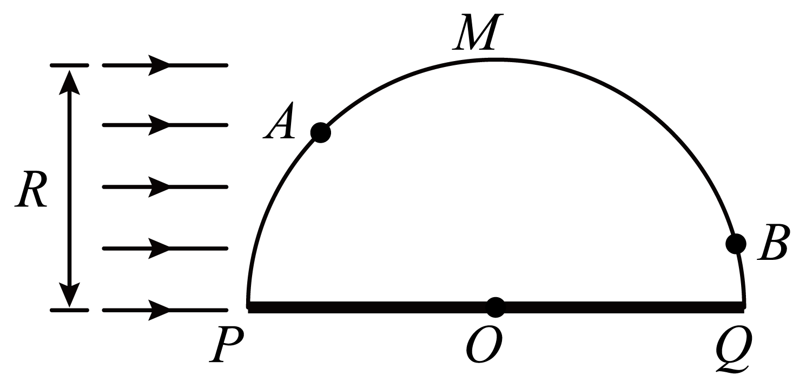

# Physics - 题目 981

**ID**: 46cdcac8a18e42d683ed20f351fed9ce
**年级**: Grade 11
**难度**: Medium
**题型**: Multiple-choice

## 题目
半圆柱形玻璃砖的底面镀有一层反射膜， $PMQ$ 为玻璃砖的半圆形横截面，M为最高点，O为圆心，半径为R。​​​​​​​‌一束宽为R的平行光的下边恰好沿着底边 $PQ$ ，如图所示。其中从A点射入的光线经玻璃折射后从B点射出，已知A、B两点距离 $PQ$ 分别为 $\frac {\sqrt {2}}{2}R$ 和 $0.26R$ 。 $\sin 15{}\degree =0.26$ ，不考虑圆弧面上的反射光线，下列说法正确的是（      ）

## 解答

1. 由题意可得，从A点射入的光线经玻璃折射后从B点射出，其光路图如图所示，由几何知识可知入射角 $α=45{^{\circ }}$ ，折射角 $r=30{}\degree $ ，则有折射率
2. 
3. $n=\frac {\sin α}{\sin r}=\sqrt {2}{\rm ，A}$ 错误；光线在玻璃砖中传播时，光线与半径构成等腰三角形，由光路可逆性可知，不可能发生全反射，B错误；假设有光线会射向 $PQ$ ，如图解所示，则有
4. 
5. $n=\frac {\sin α}{\sin β}$ ， $α=β+θ>2β\sqrt {2}=\frac {\sin α}{\sin β}>\frac {\sin 2β}{\sin β}=2{\cos}β$  $β>45{}\degree $ 不存在，D错误；最上边和下边的光线恰好射向Q点，其余光线因为 $MQ$ 区域的出射点总比 $PM$ 区域的入射点位置低，只有部分区域有光线射出，C正确。

## 知识点

**中文**:
  - 全反射与折射的综合应用

**English**:
  - Comprehensive Application of Total Reflection and Refraction

---
