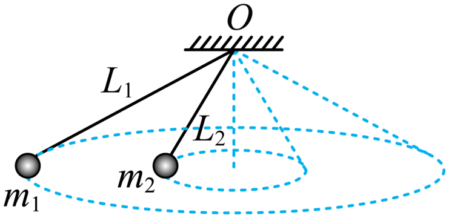

# Physics - 题目 1922

**ID**: 4a9ff137d9394d8c83fd0731ba7059a9
**年级**: Grade 11
**难度**: Medium
**题型**: Multiple-choice

## 题目
如图所示，两根长度不同的细线分别系有两个完全相同的小球，细线的上端都系于 $O$ 点。​​​​​​​‌设法让两个小球均在同一水平面上做匀速圆周运动。已知 $L{{}_{{{1}}}}$ 跟竖直方向的夹角为 $53{}\degree 、L{{}_{2}}$ 跟竖直方向的夹角为 $37{}\degree $ ，下列说法正确的是（      ）

## 解答

1. 对圆锥摆的小球分析，设摆线与竖直方向夹角为 $θ$ ，则有 $mg{\tan}θ=mω{^{2}}h{\tan}θ$ ，解得 $ω=\sqrt {\frac {g}{h}}$ ，则小球 $m{{}_{1}}$ 和 $m{{}_{2}}$ 的角速度大小之比为 $\frac {ω{{}_{1}}}{ω{{}_{2}}}=\frac {1}{1}{\rm ，A}$ 错误；对圆锥摆的小球分析，设摆线与竖直方向夹角为 $θ$ ，则有 $F=\frac {mg}{{\cos}θ}$ ，则细线 $L{{}_{1}}$ 和细线 $L{{}_{2}}$ 所受的拉力大小之比为 $\frac {F{{}_{1}}}{F{{}_{2}}}=\frac {{\cos}37{}\degree }{{\cos}53{}\degree }=\frac {4}{3}{\rm ，B}$ 错误；对圆锥摆的小球分析，设摆线与竖直方向夹角为 $θ$ ，则有 $F{{}_{向}}=mg{\tan}θ$ ，则小球 $m{{}_{1}}$ 和 $m{{}_{2}}$ 的向心力大小之比为 $\frac {F{{}_{向{{1}}}}}{F{{}_{向2}}}=\frac {{\tan}53{}\degree }{{\tan}37{}\degree }=\frac {16}{9}{\rm ，C}$ 正确；对圆锥摆的小球分析，设摆线与竖直方向夹角为 $θ$ ，则有 $mg{\tan}θ=m\frac {v{^{2}}}{h{\tan}θ}$ ，解得 $v=\sqrt {gh}{\tan}θ$ ，则小球 $m{{}_{1}}$ 和 $m{{}_{2}}$ 的线速度大小之比为 $\frac {v{{}_{1}}}{v{{}_{2}}}=\frac {{\tan}53{}\degree }{{\tan}37{}\degree }=\frac {16}{9}{\rm ，D}$ 错误。

## 知识点

**中文**:
  - 圆锥摆问题

**English**:
  - Conical Pendulum Problems

---
