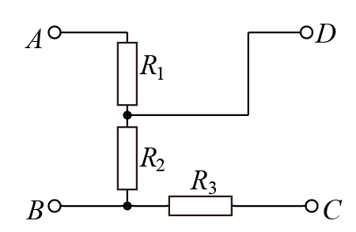

# Physics - 题目 1566

**ID**: 4baf93c048644e86a2ad1d3396a0fc8e
**年级**: Grade 11
**难度**: Medium
**题型**: Multiple-choice

## 题目
如图所示，三个定值电阻R_{1}、R_{2}、R_{3}的电阻值均不相等，在A、B之间接一个电源，在C、D之间接一个电流表，电流表的示数为I．现将电源、电流表的位置互调，则电流表的示数（      ）​​​​​​​‌

## 解答

1. 两种情况下的电路连接如图所示
2. 
3. 设电源电压为U=6V，R_{1}=3Ω，R_{2}=2Ω，R_{3}=6Ω，在甲图中  $R{{}_{甲并}}{\rm{=}}\frac {R{{}_{2}}\cdot R{{}_{3}}}{R{{}_{2}}+R{{}_{3}}}=1.5{\rm{Ω}}$ ， $\frac {U{{}_{1}}}{U{{}_{甲并}}}{\rm{=}}\frac {R{{}_{1}}}{R{{}_{甲并}}}{\rm{=}}\frac {2}{1}$ ， $U{{}_{甲并}}{\rm{=}}\frac {U}{3}=\frac {1}{3}\times 6{\rm{V}}=2{\rm{V}}$ ，电流表的示数为 $I{{}_{甲}}{\rm{=}}\frac {U{{}_{甲并}}}{R{{}_{3}}}=\frac {2{\rm{V}}}{6{\rm{Ω}}}=\frac {1}{3}{\rm{A}}$ ，在乙图中  $R{{}_{乙并}}{\rm{=}}\frac {R{{}_{1}}\cdot R{{}_{2}}}{R{{}_{1}}+R{{}_{2}}}=1.2{\rm{Ω}}$ ， $\frac {U{{}_{3}}}{U{{}_{乙并}}}{\rm{=}}\frac {R{{}_{3}}}{R{{}_{乙并}}}{\rm{=}}\frac {5}{1}$ ， $U{{}_{乙并}}{\rm{=}}\frac {U}{6}=\frac {1}{6}\times 6{\rm{V}}=1{\rm{V}}$ ，电流表的示数为 $I{{}_{乙}}{\rm{=}}\frac {U{{}_{乙并}}}{R{{}_{1}}}=\frac {{{1}}{\rm{V}}}{3{\rm{Ω}}}=\frac {1}{3}{\rm{A}}$ ，两次示数相同则，选C。

## 知识点

**中文**:
  - 串联电路和并联电路中的电流、电压、电阻的关系及其应用

**English**:
  - I, U, R Relations in Series/Parallel Circuits

---
