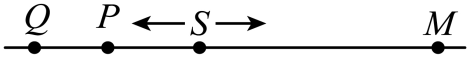
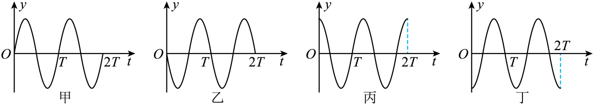

# Physics - 题目 408

**ID**: 4d60eaff860f4fb2873be992154d1816
**年级**: Grade 11
**难度**: Medium
**题型**: Multiple-choice

## 题目
如图所示，波源 $S$ 从平衡位置 $y=0$ 开始振动，运动方向竖直向上（ $y$ 轴的正方向），振动周期 $T=0.01{\rm{s}}$ ，产生的机械波向左、右两个方向传播，波速均为 $v=80{\rm{m}}/{\rm{s}}$ ，经过一段时间后， $P$ 、 $Q$ 、 $M$ 三点开始振动，已知距离 $SP=1.4{\rm{m}}$ 、 $SQ=2.2{\rm{m}}$ 、 $SM=3.6{\rm{m}}$ 。​​​​​​​‌若以 $M$ 点开始振动的时刻作为计时的零点，则在下图所示的四幅振动图像中，能正确描述 $S$ 、 $P$ 、 $Q$ 、 $M$ 四点振动情况的是（      ）

## 解答

1. 波从S点传到P点、Q点和M点所用的时间分别为 $t{{}_{P}}=\frac {SP}{v}=\frac {1.4}{80}=0.0175{\rm{s}}=1.75T$ ， $t{{}_{Q}}=\frac {SQ}{v}=\frac {2.2}{80}=0.0275{\rm{s}}=2.75T$ ， $t{{}_{M}}=\frac {SM}{v}=\frac {3.6}{80}=0.045{\rm{s}}=4.5T$
2. A．以 $M$ 点开始振动的时刻作为计时的零点，此时振源S点已经振动了 $4.5T$ ，S点处于平衡位置向 $y$ 轴负方向振动，甲不是振源S点的振动图像，A错误；
3. B．以 $M$ 点开始振动的时刻作为计时的零点，此时M点由平衡位置开始向 $y$ 轴正方向振动，乙不是M点的振动图像，B错误；
4. C．以 $M$ 点开始振动的时刻作为计时的零点，此时P点已经振动了 $2.75T$ ，P点处于波谷位置，丙不是P点的振动图像，C错误；
5. D．以 $M$ 点开始振动的时刻作为计时的零点，此时Q点已经振动了 $1.75T$ ，Q点处于波谷位置，丁为Q点的振动图像，D正确。选D。

## 知识点

**中文**:
  - 波的图像和振动图像的综合应用

**English**:
  - Integrated Application of Wave and Vibration Graphs

---
