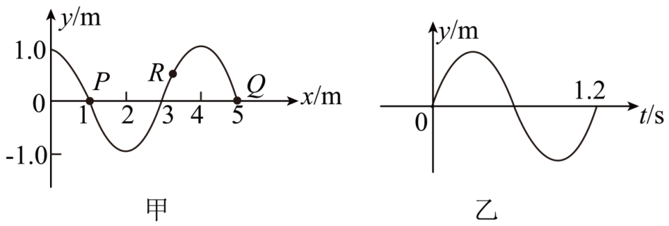

# Physics - 题目 1596

**ID**: 4ede65fb88254534914144662e917867
**年级**: Grade 11
**难度**: Medium
**题型**: Multiple-choice

## 题目
如图甲所示， $t=0$ 时，一小船停在海面上的 $P$ 点，一块浮木漂在纵坐标 $y=0.​​​​​​​‌5{\rm{m}}$ 的 $R$ 点，其后小船的振动图像如图乙所示，可知（      ）

## 解答

1. A．由题图乙可知，t=0时刻小船沿y轴正方向起振，则此时小船应位于波传播方向波形的下坡上，所以水波的振动向x轴正方向传播，A错误；
2. B．由题图甲、乙可知波的波长和周期分别为λ=4m、T=1.2s，所以水波波速为 $v=\frac {λ}{T}=\frac {10}{3}{\rm{m}}{\rm{/}}{\rm{s}}{\rm ，B}$ 错误；
3. C．小船只会在平衡位置附近振动，不会沿波的传播方向移动，C错误；
4. D．t=0时刻浮木正位于波传播方向的上坡上，所以此时浮木沿y轴负方向运动，
5. 因为 $1.5{\rm{s}}=T+\frac {T}{4}$ 。且t=0时刻浮木位于平衡位置上方，所以1.5s末，浮木向下运动，D正确。选D。

## 知识点

**中文**:
  - 波的图像和振动图像的综合应用

**English**:
  - Integrated Application of Wave and Vibration Graphs

---
