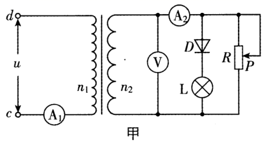
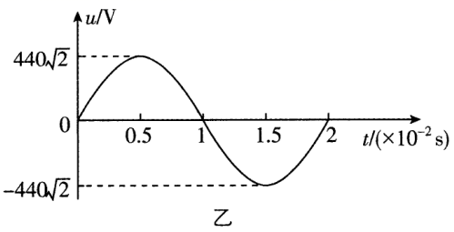

# Physics - 题目 2866

**ID**: 4f3d3e722a234f25919e9ac1973fc75f
**年级**: Grade 11
**难度**: Medium
**题型**: Multiple-choice

## 题目
如图甲所示，理想变压器原、副线圈匝数比 $n{{}_{1}}:n{{}_{2}}=55:4$ ，原线圈电路接有交流电流表 ${\rm{A}}{{}_{{\rm{1}}}}$ ，副线圈电路接有交流电压表V、交流电流表 ${\rm{A}}{{}_{{\rm{2}}}}$ 、滑动变阻器R等，所有电表都是理想电表，二极管D正向电阻为零，反向电阻无穷大，灯泡L的阻值恒定.​​​​​​​‌原线圈接入的交变电流的电压变化规律如图乙所示，则下列说法正确的是（      ）

## 解答

1. A．由题图乙可知，原线圈输入电压的有效值为440V，根据
2. $\frac {U{{}_{1}}}{U{{}_{2}}}=\frac {n{{}_{1}}}{n{{}_{2}}}$
3. 可得副线圈两端电压的有效值为32V，交流电压表V的示数为32V，故A错误；
4. B．设灯泡L两端电压的有效值为 $U{^{\prime }}$ ，灯泡的阻值为r，交变电流的周期为T，根据交变电流有效值的定义有
5. $\frac {U{{}_{2}^{2}}}{r}\cdot \frac {T}{2}=\frac {U{^{\prime 2}}}{r}T$
6. 解得
7. $U^{′}=16\sqrt {2}{\rm{V}}=22.6{\rm{V}}$
8. 故B正确；
9. C．当滑动变阻器的滑片P向下滑动时，滑动变阻器接入电路的阻值减小，由欧姆定律可知，电流表 ${\rm{A}}{{}_{{\rm{2}}}}$ 示数变大，由
10. $\frac {I{{}_{1}}}{I{{}_{2}}}=\frac {n{{}_{2}}}{n{{}_{1}}}$
11. 可知，电流表 ${\rm{A}}{{}_{{\rm{1}}}}$ 示数也变大，故C错误；
12. D．交流发电机转子的角速度为
13. $ω=\frac {2π}{T}=100{\rm{π}}\{\rm{r}}{\rm{a}}{\rm{d}}/{\rm{s}}$
14. 故D错误。
15. 故选B。

## 知识点

**中文**:
  - 含有理想变压器的动态电路分析
  - 理想变压器原、副线圈两端的电压、功率、电流关系及其应用

**English**:
  - Dynamic Circuit Analysis with Ideal Transformers
  - Voltage, Power, Current Relations in Ideal Transformers

---
