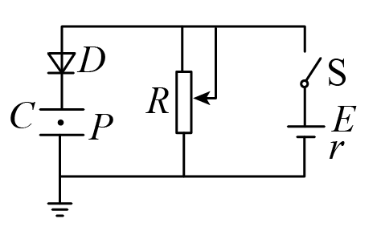

# Physics - 题目 2368

**ID**: 55d6fd2c5d834876a80521ae323266b4
**年级**: Grade 11
**难度**: Medium
**题型**: Multiple-choice

## 题目
如图所示，直流电源、滑动变阻器、平行板电容器与理想二极管（正向电阻为0，反向电阻为 $\infty $ ）连接，电源负极接地，开始时电容器不带电，闭合开关S，稳定后，一带电油滴恰能静止在电容器中P点。​​​​​​​‌在开关S保持接通的状态下，下列说法正确的是（      ）

## 解答

1. A．当滑动变阻器的滑片向上滑动时，变阻器有效阻值增大，R的电压增大，则电容器板间电压增大，场强增大，油滴所受的电场力增大，所以带电油滴会向上运动，选项A错误；
2. B．当电容器的上极板向上移动时，由电容的决定式 $C=\frac {εS}{4πkd}$ 知电容减小，而电容器的电压不变，由 $C=\frac {Q}{U}$ 知Q要减小，电容器要放电，由于二极管的单向导电性，所以电容器不能放电，则电容器的带电量不变，根据推论可知电容器板间场强不变，油滴所受的电场力不变，所以带电油滴仍静止不动，选项B错误；
3. C．当电容器的下极板向下移动时，电容器所带的电量Q不变，由 $E=\frac {4πkQ}{εS}$
4. 知电容器板间场强不变，由U=Ed知P与下极板间的电势差变大，P点的电势会升高，选项C错误；
5. D．当电容器的下极板向左移动时，根据 $C=\frac {εS}{4πkd}$ 知电容器的电容减小，由 $C=\frac {Q}{U}$ 知Q要减小，电容器要放电，由于二极管的单向导电性，所以电容器不能放电，则电容器的带电量不变，那么只能是极板间U增大，由 $E=\frac {U}{d}$ 知电容器板间场强变大，则P与下极板间的电势差变大，P点的电势升高，选项D正确。选D。

## 知识点

**中文**:
  - 电容器与力学知识的综合
  - 电容器的充放电过程及其动态分析

**English**:
  - Integration of Capacitors and Mechanics
  - Capacitor Charge/Discharge and Dynamic Analysis

---
