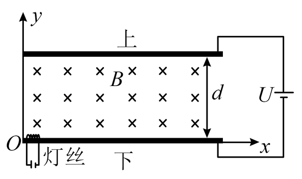

# Physics - 题目 2385

**ID**: 758448b9c2874539a5b180413ddad8be
**年级**: Grade 11
**难度**: Medium
**题型**: Multiple-choice

## 题目
如图所示，在间距为d且足够长的两平行金属板间接有电源，电源的输出电压U（大小可调），两板间存在方向垂直xOy平面向里、大小为B的匀强磁场。​​​​​​​‌紧帖下极板的灯丝持续发射初速度为0的电子，电子电荷量为e，质量为m，不计电子重力及电子间的相互作用力，忽略灯丝形状和大小的影响。下列说法正确的是（      ）

## 解答

1. 电子在两金属板间受到竖直向上的电场力，随着速度增大还受洛伦兹力，洛伦兹力的大小和方向都不断变化，根据力的合成可知电子的速度不断变化，所受合力大小和方向都不断变化，则电子在两金属板间的运动轨迹为曲线，不可能是圆周，AB错误；将阴极表面附近的灯丝持续发射初速度可近似为零的电子，分解成水平向右和水平向左大小相等的两个分速度 $v$ ，其中水平向右分速度 $v$ 产生竖直向下的洛伦兹力刚好与电场力平衡，水平向左分速度 $v$ 产生竖直向上的洛伦兹力使电子做顺时针方向的匀速圆周运动，则电子在极板间的运动可看成水平向右的匀速直线运动和顺时针方向的匀速圆周运动，则有 $evB=e\frac {U}{d}$ ， $evB=m\frac {v{^{2}}}{R{{}_{0}}}$ ，可得 $v=\frac {U}{{\rm dB}}$ ， $R=\frac {mv}{eB}=\frac {mU}{e{\rm dB}{^{2}}}$ ，当电子恰好不会碰到上金属板时有 $R=\frac {mU}{e{\rm dB}{^{2}}}=\frac {d}{2}$ ，可得 $U=\frac {d{^{2}}B{^{2}}e}{2m}$ ，电子运动的周期为 $T=\frac {2πm}{eB}=πd\sqrt {\frac {2m}{Ue}}$ ，电子一个周期内沿x轴方向运动的位移大小为 $s=vT$ ，联立可得 $x=πd{\rm ，D}$ 正确，C错误。

## 知识点

**中文**:
  - 带电粒子在叠加场中的运动

**English**:
  - Motion in Superimposed Fields

---
