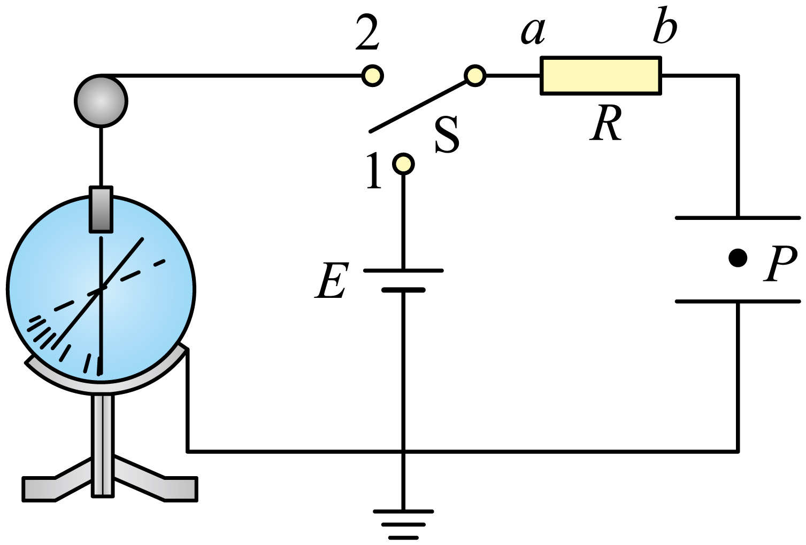

# Physics - 题目 883

**ID**: 8ded2b3fba874e9b994bdf6186d19729
**年级**: Grade 11
**难度**: Medium
**题型**: Multiple-choice

## 题目
平行板电容器与静电计、直流电源如图所示连接，电源的负极与静电计外壳相连并接地，R为定值电阻。​​​​​​​‌当单刀双掷开关打到1， 电路稳定时一带电的油滴恰好静止于两极板间的P点。以下操作中说法正确的是（      ）

## 解答

1. AB．若开关与1保持连接，电容器两端的电压不变，当将一适当厚度的玻璃板插入电容器极板间时，根据 $C=\frac {εS}{4kπd}$ ，可知电容器的电容增大，极板上的电荷量 $Q=CU$ 增大，相当于给电容器充电，电阻R中有由a流向b的电流，此时，极板间的距离减小，电场强度增大，油滴向上运动，AB错误；
2. C．若将开关打到2， 电路稳定后，电容器的电荷量不变，保持电容器上极板不动，将下极板稍微上移一点距离，根据 $C=\frac {εS}{4kπd}$ ，可知，电容器的电容增大，电容器两端的电压 $U=\frac {Q}{C}$ 减小，静电计的张角变小，在结合电场强度与电势差的关系 $E=\frac {U}{d}$ ，整理可得 $E=\frac {4πkQ}{εS}$ ，可知，电场强度不变，油滴仍处于静止，C错误；
3. D．若将开关打到2， 电路稳定后，电容器的电荷量不变，将上极板稍微向左移一点距离，则正对面积S减小，结合上述分析 $E=\frac {4πkQ}{εS}$ ，可知，电场强度增大，油滴将向上运动，由于油滴距下极板的距离不变，根据 $φ=Ed$ ，可知P点的电势升高，根据受力分析可知油滴带负电，其在P点的电势能减小，D正确。选D。

## 知识点

**中文**:
  - 平行板电容器电容大小及其影响因素

**English**:
  - Factors Affecting Capacitance of Parallel Plate Capacitors

---
