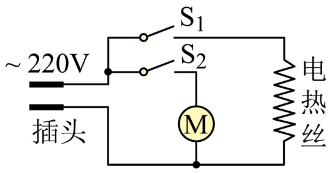

# Physics - 题目 1895

**ID**: a0453528e76f48df8180bc6b7ab9be00
**年级**: Grade 11
**难度**: Medium
**题型**: Multiple-choice

## 题目
某电吹风简化电路如图所示，其主要部件为电动机M和电热丝，部分技术参数如下表，电吹风在220V电压下工作。​​​​​​​‌下列说法正确的是（      ）额定电压220V额定功率热风时：990W冷风时：110W

## 解答

1. 由电路图可知，开关S_{1}、S_{2}都闭合时电动机M和电热丝同时接入电路，电吹风吹热风，A错误；开关S_{1}、S_{2}都闭合时电动机M和电热丝同时接入电路，电吹风吹热风，此时电热丝的功率为 $P=P{{}_{2}}-P{{}_{1}}=990{\rm{W}}-110{\rm{W}}=880{\rm{W}}$ ，电流为 $I=\frac {P}{U}=\frac {880}{220}{\rm{A}}={{4}}{\rm{A}}{\rm ，B}$ 正确，C错误；只有开关S_{2}闭合时，仅电动机接入电路，若电动机为纯电阻，其电阻为 $r=\frac {U{^{2}}}{P{{}_{1}}}=440Ω$ ，由于电动机正常工作时为非纯电阻，则电阻不为440Ω，D错误。

## 知识点

**中文**:
  - 非纯电阻电路中的电功、电功率和电热

**English**:
  - Work, Power, and Heat in Non-Pure Resistive Circuits

---
