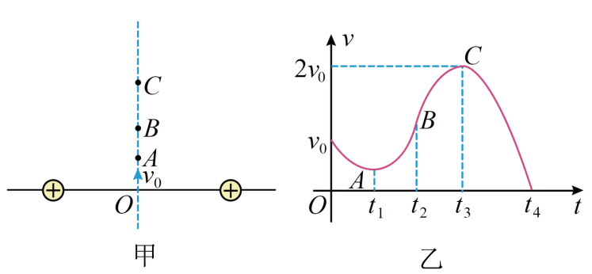

# Physics - 题目 2822

**ID**: aa7835a4150f4c18b2b943c582f7cf21
**年级**: Grade 11
**难度**: Medium
**题型**: Multiple-choice

## 题目
如图甲所示，绝缘粗糙水平面上固定两个等量的正电荷，二者连线中点O处有一质量为m、电荷量大小为q的带电小物块（可视为质点），沿中垂线方向水平射出，途经A、B、C三点，小物块在A点速度最小，C点速度最大。​​​​​​​‌小物块速度随时间变化的图像如图乙所示，整个图像在B点的切线斜率绝对值最大。已知小物块与水平面间的动摩擦因数为$μ=0.5$ ，重力加速度为g，下列说法正确的是（      ）

## 解答

1. 由题意可知，整个图像在B点的切线斜率绝对值最大，而斜率即表示加速度，小物块在B点时的加速度最大，A错误；由图乙可知小物块先做加速度减小的减速后又做加速运动，若物块带负电会一直减速至0再反向加速，物块只能带正电，B错误；由图乙可知，A、C两点的加速度为0，小物块所受合力为0，得 $qE-F{{}_{{\rm{f}}}}=0$ ，而 $F{{}_{{\rm{f}}}}={\rm μm}g$ ，联立并代入数据得A、C两点的电场强度大小均为 $E=\frac {mg}{2q}{\rm ，C}$ 正确；0~t₁时间内，小物块由O运动到A，电场力一直增大并做正功，电势能一直减小，D错误。

## 知识点

**中文**:
  - 静电场中的图像问题

**English**:
  - Graph Problems in Electrostatic Fields

---
