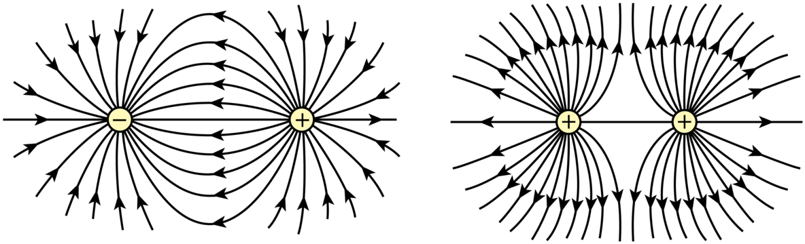

# Physics - 题目 178

**ID**: adce60ef54d84f7c805c217b02061e73
**年级**: Grade 11
**难度**: Medium
**题型**: Multiple-choice

## 题目
等量异种点电荷的电场线和等量同种点电荷的电场线如下图所示，下列选项正确的是（      ）​​​​​​​‌

## 解答

1. 电场线密的地方电场强度大，根据等量异种点电荷电场线的分布情况可知，两电荷连线上的电场强度在中点处最小，A错误；对于等量异种点电荷，两电荷连线中垂线是等势线，中垂线上的电势处处相等，B错误；根据电场线可知，等量同种正点电荷，两电荷连线中垂线上关于中点对称的两点电势相等，C正确；根据图像可知，等量同种正点电荷，两电荷连线上关于中点对称的两点，电场强度大小相等、方向相反，D错误。

## 知识点

**中文**:
  - 几种常见的电场

**English**:
  - Several Common Electric Fields

---
