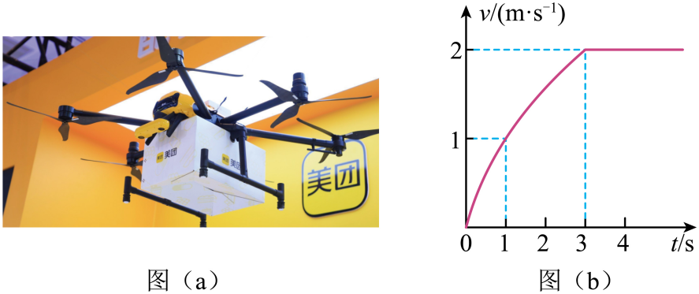

# Physics - 题目 749

**ID**: b1ab9758f6e14a64ad0c415e500d3fcf
**年级**: Grade 11
**难度**: Medium
**题型**: Multiple-choice

## 题目
目前，无人机已经成为物流行业升维战的新武器。​​​​​​​‌据官方数据，截止2023年8月底，中国美团无人机已经在深圳、上海等城市建立了7个商圈和17条航线，为14个社区写字楼和4个5A级景区提供了无人机配送服务。如图（a）所示，某次一架无人机在恒定升力F的作用下从地面静止竖直向上升起，其运动图像如图（b）所示。已知无人机飞行时受到的空气阻力与速率成正比，即 $f=kv$ ，方向与速度方向相反，则下列说法正确的是（      ）

## 解答

1. 速度—时间图像的面积表示位移，若无人机在前 $3{\rm{s}}$ 内做匀变速直线运动，则其位移应为 $x=3\times 2\times \frac {1}{2}{\rm{m}}=3{\rm{m}}$ ，而根据图像可知，在前 $3{\rm{s}}$ 内无人机任意时刻的速度大小都大于任意时刻所对应的匀变速直线运动的速度大小，因此可知，无人机前 $3{\rm{s}}$ 内的位移大于 $3{\rm{m}}{\rm ，A}$ 错误；由图b可知，无人机在第 $3{\rm{s}}$ 后做匀速直线运动，而不是悬停，B错误；根据速度时间图像可知，无人机先做加速度逐渐减小的加速运动，后做匀速直线运动，根据牛顿第二定律有 $(F-kv)-mg=ma$ ，空气对无人机的作用力即为升力与空气阻力的合力，可知，升力与空气阻力的合力先逐渐减小，而当无人机做匀速直线运动时有 $(F-kv)-mg=0$ ，即升力与阻力的合力后不变，因此可知，前 $4{\rm{s}}$ 空气给无人机的作用力先逐渐减小后不变，C正确；无人机在第4秒过程中，除重力做功外，空气作用力对无人机做正功，因此可知，无人机的机械能增加，D错误。

## 知识点

**中文**:
  - 功能原理、能量守恒与曲线运动的综合

**English**:
  - Energy Conservation in Curvilinear Motion

---
