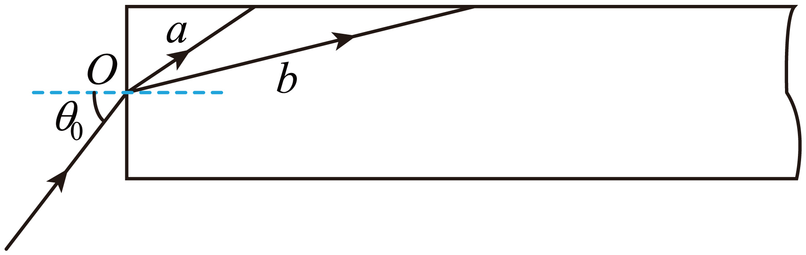

# Physics - 题目 562

**ID**: bad1e3677ebe4169a59c1e2df38cc79d
**年级**: Grade 11
**难度**: Medium
**题型**: Multiple-choice

## 题目
光纤通信采用光导纤维，可简化为半径为 $r$ 、长为 $L$ （ $L\gg r$ ）的圆柱形长玻璃丝。​​​​​​​‌为简化可认为玻璃丝外为空气，其沿轴线的侧剖面如图所示。一束含红、绿两种颜色的复色光以入射角 $θ{{}_{0}}$ 从轴心射入后分为 $a$ 、 $b$ 两束，两单色光在玻璃中多次全反射后从光导纤维另一端射出，已知该玻璃材料对 $a$ 光的折射率为 $n$ ，真空中的光速为 $c$ 。下列说法正确的是（      ）

## 解答

1. AB．根据折射定律
2. $n=\frac {\sin θ{{}_{0}}}{\sin r}$
3. 可得
4. $n{{}_{a}}=n<n{{}_{b}}$
5. 由于红光折射率最小，可得 $a$ 光为红光， $b$ 光为绿光，AB错误；
6. C．若 $a$ 光恰好发生全反射，其中
7. $n=\frac {1}{\sin C}$
8. 则 $a$ 光在该玻璃丝中的传播时间
9. $t=\frac {s}{v}=\frac {\frac {L}{\sin C}}{\frac {c}{n}}=\frac {n{^{2}}L}{c}$
10. C正确；
11. D．光从左侧面的入射角为 $90{}\degree $ 时，光进入光纤的折射角最大，且等于临界角，即
12. $r=C$
13. 此时光在光纤侧壁的入射角有最小值
14. $i=90{}\degree -r$
15. 要使光所有入射光线均能在侧壁发生全反射，则
16. $i⩾C$
17. 联立解得
18. $C⩽45{}\degree $
19. 其中
20. $n=\frac {1}{\sin C}$
21. 解得
22. $n⩾\sqrt {2}$
23. D错误。
24. 选C。

## 知识点

**中文**:
  - 全反射与折射的综合应用

**English**:
  - Comprehensive Application of Total Reflection and Refraction

---
