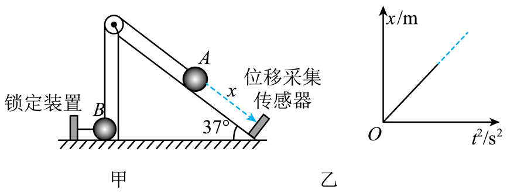

# Physics - 题目 567

**ID**: bbc8488cebb2498985cb0c76570c7627
**年级**: Grade 11
**难度**: Medium
**题型**: Multiple-choice

## 题目
城市高层建筑建设施工，往往采用配重的方式把装修材料运送到高处，精简模型如图甲所示，固定于水平面上倾角为37°的斜面，绕过顶端定滑轮的轻绳连接两小球A、B（可视作质点），质量分别为M和m，B小球被固定于地面上的锁定装置锁定，某时刻解除锁定，安装在斜面底端的位移采集传感器采集到A在斜面上下滑的位移x与时间t的二次方关系如图乙所示，若该图像的斜率为k，不考虑一切摩擦， 重力加速度取 $g=10{\rm{m}}{\rm{/}}{\rm{s}}{^{{{2}}}}$ ， sin37°=0.​​​​​​​‌6，则A与B的质量之比为（      ）

## 解答

1. 解除锁定后，沿绳方向上对A、B和绳组成的系统，由牛顿第二定律有 $Mg{\rm{s}}{\rm{i}}{\rm{n}}θ-mg=\left ({M+m}\right )a$ ，对A，由运动学规律有 $x=\frac {1}{2}at{^{2}}$ ，联立解得 $x=\frac {1}{2}\frac {Mg\sin θ-mg}{M+m}t{^{2}}$ ，结合图像，斜率 $k=\frac {1}{2}\frac {Mg\sin θ-mg}{M+m}$ ，解得 $\frac {M}{m}=\frac {k+5}{3-k}$ 。

## 知识点

**中文**:
  - 牛顿运动定律与图像结合问题

**English**:
  - Newton's Laws and Graphs

---
