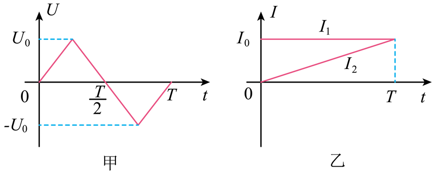

# Physics - 题目 2345

**ID**: bf5eb635b64349d5b648f652d7e4db34
**年级**: Grade 11
**难度**: Medium
**题型**: Multiple-choice

## 题目
已知图甲中三角形脉冲交流电电压的峰值是有效值的 $\sqrt {3}$ 倍，则图乙中I_{1}、I_{2}两个电流流经相同电阻R，在0~T时间内发热的比值为（      ）​​​​​​​‌

## 解答

1. 由于三角形脉冲交流电电压的峰值是有效值的 $\sqrt {3}$ 倍，类比可知，若图甲是电流与时间的关系，则三角形脉冲交流电电流的峰值也是有效值的 $\sqrt {3}$ 倍，则根据图乙有 $Q{{}_{1}}=I{{}_{1}^{2}}RT$ ， $Q{{}_{2}}={\left({\frac {I{{}_{1}}}{\sqrt {3}}}\right)^{2}}RT$ ，解得 $Q{{}_{1}}:Q{{}_{2}}=3:1$ 。

## 知识点

**中文**:
  - 交变电流的峰值和有效值

**English**:
  - Peak and RMS Values of AC

---
