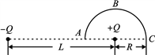

# Physics - 题目 1806

**ID**: cac4062fa7764e78a4cb949745ea99ab
**年级**: Grade 11
**难度**: Medium
**题型**: Multiple-choice

## 题目
以无穷远处的电势为零，在电荷量为q的点电荷周围某点的电势可用 $ϕ=\frac {kq}{r}$ 计算，式中r为该点到点电荷的距离，k为静电力常量。​​​​​​​‌两电荷量大小均为Q的异种点电荷固定在相距为L的两点，如图所示。现将一质子（电荷量为e）从两点电荷连线上的A点沿以电荷+Q为圆心、半径为R的半圆形轨迹ABC移到C点，质子从A移到C的过程中电势能的变化情况为

## 解答

1. A点的电势为
2. $φ{{}_{A}}=k\frac {Q}{R}-k\frac {Q}{L-R}=-\frac {kQ(L-2R)}{R(L-R)}{\rm \mathit{C}}$ 点的电势为
3. $φ{{}_{C}}=k\frac {Q}{R}-k\frac {Q}{L+R}=\frac {kQL}{R\left ({L+R}\right )}$
4. 则A、C间的电势差为
5. $U{{}_{AC}}=φ{{}_{A}}-φ{{}_{C}}=-\frac {kQ(d-2R)}{R(d-R)}-\frac {kQd}{R\left ({d+R}\right )}=-\frac {2kQR}{L{^{2}}-R{^{2}}}$
6. 质子从A移到C，电场力做功为
7. $ W{{}_{AC}}=eU{{}_{AC}}=-\frac {2kQeR}{L{^{2}}-R{^{2}}}$
8. 是负功，所以质子的电势能增加 $ \frac {2kQeR}{d{^{2}}-R{^{2}}}$ 。
9. 故选B。

## 知识点

**中文**:
  - 电势差

**English**:
  - Electric Potential Difference

---
