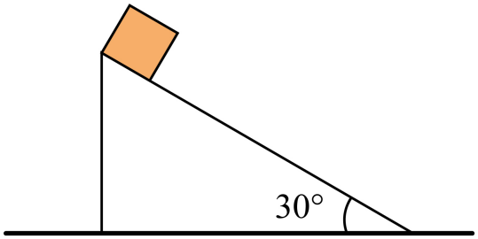

# Physics - 题目 579

**ID**: cb98d71a7ced4939a7c992210e458594
**年级**: Grade 11
**难度**: Medium
**题型**: Multiple-choice

## 题目
如图所示，有一质量为2m的光滑斜面体静止地放在光滑的水平地面上，斜面倾角为 $30{}\degree $ ，斜面长2L，将质量为m的滑块（视为质点）从斜面体顶端由静止释放，滑块沿斜面下滑的过程中，滑块的加速度大小为 $a{{}_{1}}$ ，斜面体的加速度大小为 $a{{}_{2}}$ ，下列说法正确的是（      ）​​​​​​​‌

## 解答

1. 由题意可知，滑块沿斜面下滑的过程中，滑块和斜面体组成的系统水平方向合外力为零，竖直方向合外力不为零，因此系统水平方向动量守恒，竖直方向动量不守恒，总动量不守恒。设某一时刻，滑块水平速度为 $v{{}_{1x}}$ ，斜面体速度为 $v{{}_{2}}$ ，则有 $mv{{}_{1x}}=2mv{{}_{2}}$ ，解得 $v{{}_{1x}}=2v{{}_{2}}$ ，任一时刻水平速度都保持上述关系，且经历时间相同， $a{{}_{1x}}:a{{}_{2}}=2:1$ ，又因为滑块有竖直方向的加速度 $a{{}_{1y}}$ ，即 $a{{}_{1}}=\sqrt {a{{}_{1x}}{^{2}}+a{{}_{1y}}{^{2}}}$ ，可见 $a{{}_{1}}:a{{}_{2}}>2:1{\rm ，A}$ 、B错误；由于系统水平方向动量守恒，有 $mv{{}_{1x}}=2mv{{}_{2}}$ ，两者经历相同时间，设滑块从顶端滑至斜面底端的过程中，走过的水平位移大小为 $x{{}_{1}}$ ，斜面体走过的水平位移大小为 $x{{}_{2}}$ ，所以 $mx{{}_{1}}=2mx{{}_{2}}$ ，又有 $x{{}_{1}}+x{{}_{2}}=2L{\cos}30{}\degree =\sqrt {3}L$ ，联立解得 $x{{}_{2}}=\frac {\sqrt {3}L}{3}{\rm ，C}$ 正确；滑块对斜面体的作用力方向垂直斜面向下，地面对斜面体的作用力方向竖直向上，D错误。

## 知识点

**中文**:
  - 人船模型

**English**:
  - Man-Boat Model

---
