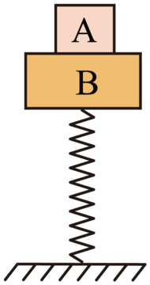

# Physics - 题目 2256

**ID**: cf2c6e388b3e4903a48658e632842cba
**年级**: Grade 11
**难度**: Medium
**题型**: Multiple-choice

## 题目
如图，叠放在一起但不粘连的物块 ${\rm{A}}$ 、 ${\rm{B}}$ 与轻质弹簧构成的弹簧振子在竖直方向做简谐运动。​​​​​​​‌A、B一起运动到最高点时，弹簧恰好处于原长状态，此时用竖直向上的力瞬间将物块 ${\rm{A}}$ 拿走，物块 ${\rm{B}}$ 将继续做简谐运动。以地面为重力势能参考平面，则与拿走 ${\rm{A}}$ 之前相比，两简谐运动相同的是（      ）

## 解答

1. 设A的质量为m，B的质量为M，AB组成的整体在平衡位置时 $(M+m)g=kx{{}_{1}}$ ，可得 $x{{}_{1}}=\frac {(M+m)g}{k}{\rm ，B}$ 在平衡位置时 $Mg=kx{{}_{2}}$ ，可得 $x{{}_{2}}=\frac {Mg}{k}$ ，根据振幅的定义可知，将物块A拿走后简谐振动的振幅减小，A错误；由对称性可知，弹簧的最大形变量为简谐振动振幅的2倍，所以将物块A拿走后弹簧的最大形变量减小，B错误；在最高点弹簧的弹性势能为零，物体的动能为零，所以系统在最高点的机械能等于物体的重力势能，根据重力势能的公式可知开始时E_{p1}=（m+M）gh，后来的弹性势能E_{p2}=Mgh，可知系统的重力势能减小，则系统的机械能减少，C错误；在最高点，开始时A与B只受到重力，则加速度 $a{{}_{1}}=\frac {(M+m)g}{M+m}=g$ ，后来B也是只受到重力，则 $a{{}_{2}}=\frac {Mg}{M}=g$ ，可知物块B的最大加速度不变，D正确。

## 知识点

**中文**:
  - 弹簧振子及其运动特点

**English**:
  - Spring Oscillator and Motion Characteristics

---
