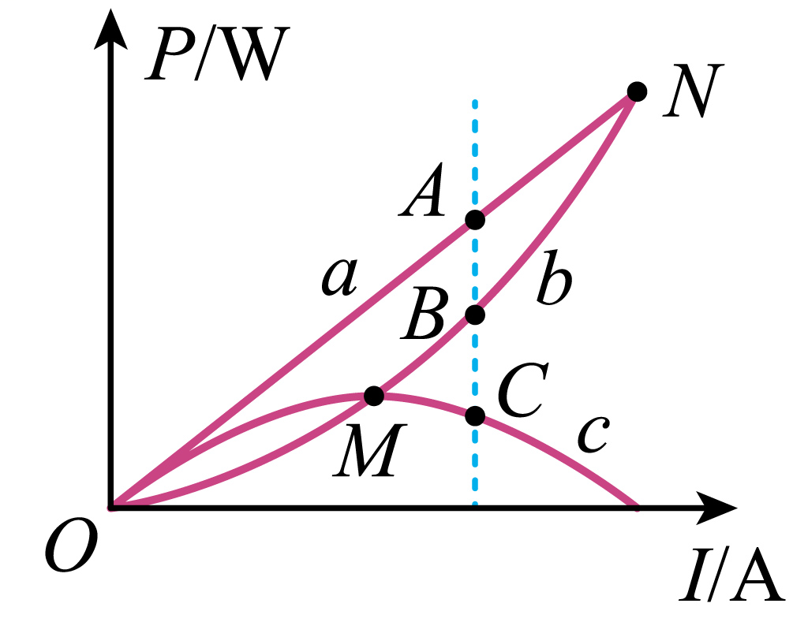

# Physics - 题目 2872

**ID**: e17c1ec2e82246f9870973e27af10d22
**年级**: Grade 11
**难度**: Medium
**题型**: Multiple-choice

## 题目
某同学将一直流电源的总功率P_{E}、输出功率P_{R}和电源内部的发热功率P_{r}随电流I变化的图线画在同一坐标系中，如图中的a、b、c所示。​​​​​​​‌则下列说法中正确的是（      ）

## 解答

1. AC．根据闭合电路的欧姆定律及功率的计算公式可知
2. $P{{}_{E}}=EI$ ， $P{{}_{r}}=I{^{2}}r$ ， $P{{}_{R}}=IE-I{^{2}}r$
3. 故a图线为总功率的图线，b为电源内部损失功率图线，c图线为输出功率的图线，则有
4. $P{{}_{A}}=P{{}_{B}}+P{{}_{C}}$
5. 故A错误，C正确；
6. B．根据上述分析可知，M点为电源输出功率最大的点，不是N点，故B错误；
7. D．当外电路的电阻与内电路的电阻相等时，电源的输出功率最大，故M点的纵横坐标分别为
8. $P{{}_{My}}=\frac {E{^{2}}}{4r}$
9. $I{{}_{Mx}}=\frac {E}{2r}{\rm \mathit{N}}$ 点表示电源的总功率与其发热功率相等，即此时电路中的电阻只有电源的内阻，故N点的纵横坐标分别为
10. $P{{}_{Ny}}=\frac {E{^{2}}}{r}$
11. $I{{}_{Nx}}=\frac {E}{r}$
12. 所以两点的横坐标之比为1∶2，纵坐标之比为1∶4，故D错误。
13. 故选C。

## 知识点

**中文**:
  - 闭合电路输出功率与效率

**English**:
  - Output Power and Efficiency of Closed Circuits

---
