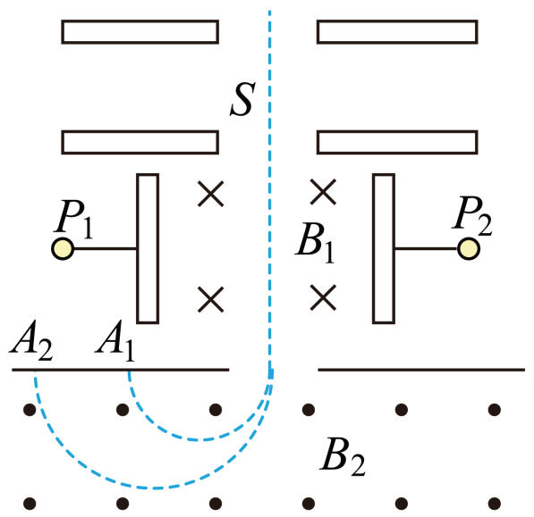

# Physics - 题目 377

**ID**: e9a861fe3620403f8f92e8d6e86225f9
**年级**: Grade 11
**难度**: Medium
**题型**: Multiple-choice

## 题目
如图所示，有 $a$ 、 $b$ 、 $c$ 、 $d$ 四个粒子，它们带同种电荷且电荷量相等，它们的速率关系为 $v{{}_{a}}<v{{}_{b}}=v{{}_{c}}<v{{}_{d}}$ ，质量关系为 $m{{}_{a}}=m{{}_{b}}<m{{}_{c}}=m{{}_{d}}$ 。​​​​​​​‌进入速度选择器后，有两种粒子从速度选择器中射出，由此可以判定（      ）

## 解答

1. 根据粒子在磁场B_{2}中的偏转方向，由左手定则可知，四种粒子带正电；粒子能通过速度选择器时有 $qE=qvB$ ，可得 $v=\frac {E}{B}$ ，结合题意可知，b、c两粒子能通过速度选择器；a的速度小于b的速度，所以a所受的静电力大于洛伦兹力，a向P_{1}板偏转；d的速度大于b的速度，所以d所受的静电力小于洛伦兹力，d向P_{2}板偏转；B错误，D正确；只有b、c两粒子能通过速度选择器进入磁场B_{2}，根据洛伦兹力提供向心力可得 $qvB{{}_{2}}=m\frac {v{^{2}}}{r}$ ，可得 $r=\frac {mv}{qB{{}_{2}}}$ ，可知质量大的轨道半径大，则射向 $A{{}_{1}}$ 的是b粒子，射向 $A{{}_{2}}$ 的是c粒子，AC错误。

## 知识点

**中文**:
  - 速度选择器

**English**:
  - Velocity Selector

---
