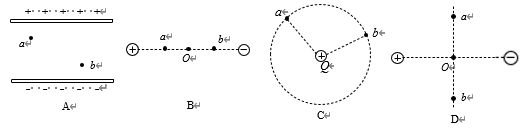

# Physics - 题目 1540

**ID**: ede3f3dde79b4134a13e7b4cb7d1b612
**年级**: Grade 11
**难度**: Medium
**题型**: Multiple-choice

## 题目
在如下图所示的A、B、C、D四种典型电场的情景中，a、b两点电场强度不相同的是（      ）​​​​​​​‌

## 解答

1. 平行板电容器带电时，两极板间为匀强电场，a、b处于匀强电场中，场强相同， A错误；a、b在等量异种电荷连线上，根据电场的对称性，a、b两点电场强度大小相等，方向相同， B错误；以点电荷为圆心的同心球面上场强大小相等，方向不同， C正确；根据两个等量异种电荷的电场线分布情况可知，在两电荷连线的中垂线上与中点等距的任意两点场强大小相等，方向相同， D错误。 选C。

## 知识点

**中文**:
  - 几种常见的电场

**English**:
  - Several Common Electric Fields

---
