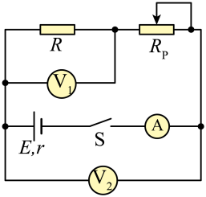

# Physics - 题目 1867

**ID**: f97d32b9f3424b108eaec261fe89496f
**年级**: Grade 11
**难度**: Medium
**题型**: Multiple-choice

## 题目
如图所示，电路中电表均可视为理想电表，闭合开关S后将滑动变阻器滑片向左滑动，下列结论正确的是（      ）​​​​​​​‌

## 解答

1. 将滑动变阻器滑片向左滑动，则 $R{{}_{{\rm{p}}}}$ 阻值减小，电路总电阻减小，总电流变大，则电流表A的示数变大，电阻R两端的电压 $U=IR$ 变大，即电压表 ${\rm{V}}{{}_{1}}$ 示数增大，根据 $U=E-Ir$ 可知，电压表 ${\rm{V}}{{}_{2}}$ 示数减小，A错误，B错误；当外电阻与电源内阻相等时电源输出功率最大，因外电阻与内阻关系不确定，则不能判断电源输出功率的变化，C错误；电阻R两端的电压 $U=IR$ ，则 $ΔU{{}_{1}}=\left ({I-I^{′}}\right )R$ ，根据 $U=E-Ir$ 可知， $ΔU{{}_{2}}=\left ({I-I^{′}}\right )r$ ，所以有 $\left |{\frac {{\rm{Δ}}U{{}_{1}}}{{\rm{Δ}}U{{}_{2}}}}\right |=\frac {R}{r}{\rm ，D}$ 正确。

## 知识点

**中文**:
  - 电路的动态分析问题

**English**:
  - Dynamic Circuit Analysis

---
