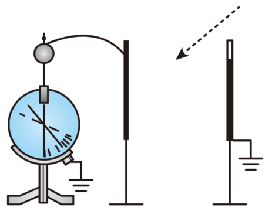

# Physics - 题目 180

**ID**: 2b5aac40f947487298244e92f38bb94b
**年级**: Grade 11
**难度**: Medium
**题型**: Multiple-select

## 题目
由锌板与铜板构成平行板电容器，其中锌板与静电计相连，静电计金属外壳和铜板都接地，现用频率 $υ{{}_{1}}$ 的紫外线照射锌板，静电计指针偏转最后稳定在偏角 $θ{{}_{0}}$ 上，对应电压 $U{{}_{0}}$ 。​​​​​​​‌假定已知偏转角度 $θ$ 与电势差U成正比。以Q表示两板带的电荷量，E表示两板间的电场强度。则下述过程中正确的是（      ）

## 解答

1. B．紫外线照射锌板，发生光电效应，飞出的电子打在铜板，两板之间形成电场，随着电场的增强，最后最大初动能的光电子也不能打在铜板上，形成遏止电压，即静电计指针偏转角 $θ{{}_{0}}$ 对应电压 $U{{}_{0}}$ 有 $U{{}_{0}}e=E{{}_{k1}}=hυ{{}_{1}}-W$ （W为锌板逸出功），换用频率 $υ{{}_{2}}$ 的紫外线继续照射锌板θ增大为2 $θ{{}_{0}}$ 稳定，则对应电压2 $U{{}_{0}}$ ，有 $2U{{}_{0}}e=E{{}_{{\rm{k}}2}}=hυ{{}_{2}}-W$ ，联立两式得 $h(υ{{}_{2}}-υ{{}_{1}})=U{{}_{0}}e$ ，选项B正确；
2. A．光照条件下，两板距离减小电容增大，电压降低，电荷量继续积累，Q增大，E增大，一直到重新回到遏止电压 $U{{}_{0}}$ ，选项A错误；
3. CD．停止光照，Q不变，E不变，两板距离增大为两倍，电压增大为两倍，即θ增大为2 $θ{{}_{0}}$ ，选项C错误，D正确。选BD。

## 知识点

**中文**:
  - 光电效应规律的综合应用

**English**:
  - Comprehensive Application of Photoelectric Effect

---
