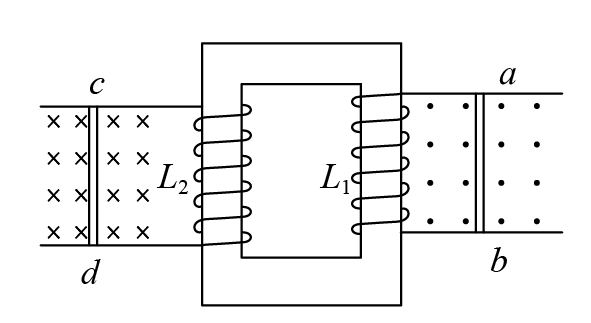

# Physics - 题目 549

**ID**: 3e2ad38e9ae943d0a8b5d354da1ec7af
**年级**: Grade 11
**难度**: Medium
**题型**: Multiple-select

## 题目
如图所示装置中，金属杆ab、cd与下方的光滑金属导轨始终接触良好，cd杆原来静止。​​​​​​​‌当ab杆做如下哪些运动时，cd杆将向左移动（      ）

## 解答

1. A．当ab杆向左匀速运动，在ab杆中产生恒定电流，该电流在线圈L_{1}中产生恒定的磁场，在L_{2}中不产生感应电流，cd杆不受安培力，静止不动，A错误；
2. B．当ab杆向左变加速运动，根据右手定则，在ab杆中产生增大的从b到a的电流，该电流在线圈L_{1}中产生向下的增强的磁场，在L_{2}中磁场向上，根据楞次定律，在cd杆上产生从d到c的电流，根据左手定则，受向左的安培力，将向左运动， B正确；
3. C．当ab杆向右加速运动，根据右手定则，在ab杆中产生增大的从a到b的电流，该电流在线圈L_{1}中产生向上的增强的磁场，在L_{2}中磁场向下，根据楞次定律，在cd杆上产生从c到d的电流，根据左手定则，受向右的安培力，将向右运动，C错误；
4. D．当ab杆向右减速运动，根据右手定则，在ab杆中产生减小的从a到b的电流，该电流在线圈L_{1}中产生向上的减小的磁场，在L_{2}中磁场向下，根据楞次定律，在cd杆上产生从d到c的电流，根据左手定则，受向左的安培力，将向左运动，D正确。选BD。

## 知识点

**中文**:
  - 互感现象及其应用

**English**:
  - Mutual Induction and Applications

---
