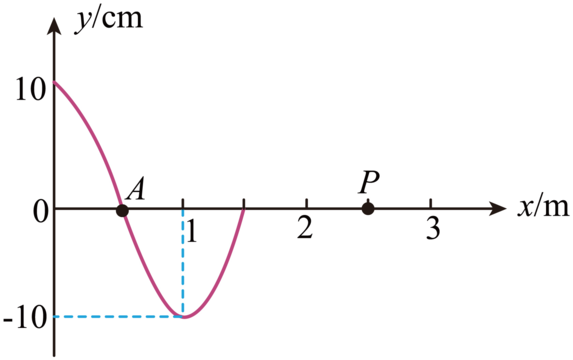

# Physics - 题目 2549

**ID**: 45f8d741be1a4fb897c3002c020f0f34
**年级**: Grade 11
**难度**: Medium
**题型**: Multiple-select

## 题目
一列简谐横波沿x正方向传播， $t=0$ 时刻的波形如图所示，质点A、P的平衡位置分别为 $x{{}_{1}}=0.5{\rm{m}}，x{{}_{2}}=2.5{\rm{m}}$ ， $t=3{\rm{s}}$ 时，质点P首次到达波谷。​​​​​​​‌下列说法正确的是（      ）

## 解答

1. 质点A只在平衡位置附近振动，并不随波迁移，A错误；如图所示，可知波长 $λ=2{\rm{m}}$ ，设波的传播周期为 $T$ ，当 $t=3{\rm{s}}$ 时，波传播到 $P$ 质点用时 $\frac {T}{2}$ ，根据波的迁移，质点P先向下振动，质点P首次到达波谷，振动时间为 $\frac {T}{4}$ ，因此可得 $t=\frac {T}{2}+\frac {T}{4}$ ，解得 $T=4{\rm{s}}$ ，该列波的传播速度 $v=\frac {λ}{T}=0.5{\rm{m}}{\rm{/}}{\rm{s}}{\rm ，B}$ 正确； $0\sim 3{\rm{s}}$ 内，波传到 $x=2{\rm{m}}$ 的质点时间 $t=\frac {T}{4}$ ，质点振动的时间为 $\frac {T}{2}$ ，质点运动的路程为 $s=2A=0.2{\rm{m}}{\rm ，C}$ 错误； $t=3{\rm{s}}$ 时，质点A处在波谷位置，此时位移为 $y=-10{\rm{c}}{\rm{m}}{\rm ，D}$ 正确。

## 知识点

**中文**:
  - 振幅、周期、频率、相位和波长及其计算
  - 简谐运动中的位移与路程问题
  - 简谐运动的函数与图像

**English**:
  - Calculation of Amplitude, Period, Frequency, Phase, and Wavelength
  - Displacement and Distance in SHM
  - Functions and Graphs of SHM

---
