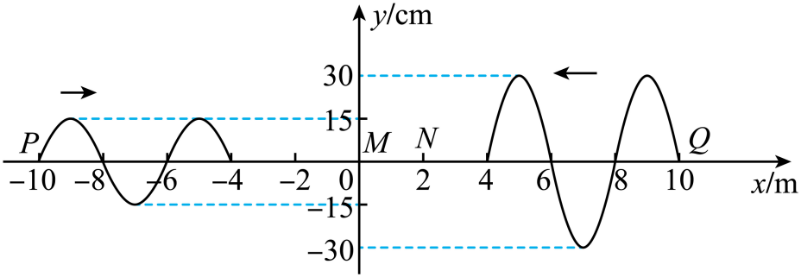

# Physics - 题目 1383

**ID**: 478bf46f20d54df3bdeca543a993dc31
**年级**: Grade 11
**难度**: Medium
**题型**: Multiple-select

## 题目
P、Q两波源分别位于x轴的-10 m和10 m处，产生的两列简谐横波分别沿x轴正方向和负方向传播，振幅分别为15 cm和30 cm。​​​​​​​‌t=0时刻两波源同时开始起振，t=3 s时的波形图如图所示，此刻平衡位置在x轴的-4 m和4 m处的两质点刚要开始振动。质点M、N的平衡位置分别为坐标原点和x=2 m处，已知两波源P、Q都刚好振动12 s就停在平衡位置，波在传播过程中能量不损失，则（      ）

## 解答

1. A：根据“上下坡法”可知， $t=3{\rm{s}}$ 时 $x=-4{\rm{m}}$ 和 $x=4{\rm{m}}$ 两处的质点的起振方向均沿y轴正方向，则两波源的起振方向均沿y轴正方向，A正确；
2. B：根据题意可知两列简谐横波的波速均为 $v=\frac {Δx}{Δt}=\frac {6}{3}{\rm{m}}/{\rm{s}}=2{\rm{m}}/{\rm{s}}{\rm ，B}$ 错误；
3. C：由图像可知两波的波长均为 $λ=4{\rm{m}}$ ，则周期为 $T=\frac {λ}{v}=2{\rm{s}}$ ，当 $t=3{\rm{s}}$ 时 $x=-4{\rm{m}}$ 和 $x=4{\rm{m}}$ 两处的振动传到质点N所用的时间分别为 $Δt{{}_{1}}=\frac {Δx{{}_{1}}}{v}=\frac {6}{2}{\rm{s}}=3{\rm{s}}$ ， $Δt{{}_{2}}=\frac {Δx{{}_{2}}}{v}=\frac {2}{2}{\rm{s}}=1{\rm{s}}$ ，可知 $0\sim 5{\rm{s}}$ 内质点N只由右边波源引起振动了 $1{\rm{s}}$ ，由于 $1{\rm{s}}=\frac {1}{2}T$ ，则 $0\sim 5{\rm{s}}$ 内质点N运动的路程为 $s=2A{{}_{Q}}=2\times 30{\rm{c}}{\rm{m}}=60{\rm{c}}{\rm{m}}{\rm ，C}$ 正确；
4. D： $t=3{\rm{s}}$ 时 $x=-4{\rm{m}}$ 和 $x=4{\rm{m}}$ 两处的振动传到质点M所用时间均为 $Δt=\frac {Δx}{v}=\frac {4}{2}{\rm{s}}=2{\rm{s}}$ ，可知 $t=5{\rm{s}}$ 时质点M开始振动，且两波源的起振方向相同，周期相同，可知质点M为振动加强点，振幅为 $A^{′}=15{\rm{c}}{\rm{m}}+30{\rm{c}}{\rm{m}}=45{\rm{c}}{\rm{m}}$ ，由于 $10{\rm{s}}-5{\rm{s}}=5{\rm{s}}=2.5{\rm{T}}$ ，则 $0\sim 10{\rm{s}}$ 内质点M运动的路程为 $s^{′}=2.5\times 4A^{′}=450{\rm{c}}{\rm{m}}=4.5{\rm{m}}{\rm ，D}$ 正确；
5. E：波源Q的波动传到N点需要时间 $t{{}_{1}}=\frac {Δx{{}_{1}}}{v}=\frac {10-2}{2}{\rm{s}}{\rm{=}}{{4}}{\rm{s}}$ ，波源P的波动传到N点需要时间 $t{{}_{2}}=\frac {Δx{{}_{2}}}{v}=\frac {10+2}{2}{\rm{s}}{\rm{=}}{{6}}{\rm{s}}$  $t=4{\rm{s}}$ 到 $t=6{\rm{s}}{\rm ，\mathit{N}}$ 点运动的路程 $s{{}_{1}}=30{\rm{c}}{\rm{m}}\times {{4}}{\rm{=}}{{1}}{{2}}{{0}}{\rm{c}}{\rm{m}}=1.2{\rm{m}}$ ，两波源P、Q都刚好振动12 s，N点在 $t=12{\rm{s}}+4{\rm{s}}{\rm{=}}{{1}}{{6}}{\rm{s}}$ ，不参与波源引起的Q振动。在 $t=12{\rm{s}}+6{\rm{s}}{\rm{=}}{{1}}{{8}}{\rm{s}}{\rm ，\mathit{N}}$ 点停止运动， $t=6{\rm{s}}$ 到 $t=16{\rm{s}}{\rm ，\mathit{N}}$ 点运动的路程 $s{{}_{2}}=(30{\rm{c}}{\rm{m}}+15{\rm{c}}{\rm{m}})\times \frac {10}{2}\times {{4}}{\rm{=}}{{9}}{\rm{m}}$  $t=16{\rm{s}}$ 到 $t=18{\rm{s}}{\rm ，\mathit{N}}$ 点运动的路程 $s{{}_{3}}=15{\rm{c}}{\rm{m}}\times {{4}}{\rm{=}}{{0}}{{.}}{{6}}{\rm{m}}$ ，质点N运动的总路程 $s=s{{}_{1}}+s{{}_{2}}+s{{}_{3}}=1.2{\rm{m}}{{+}}{{9}}{\rm{m}}+0.6{\rm{m}}=10.8{\rm{m}}{\rm ，E}$ 错误。选ACD。

## 知识点

**中文**:
  - 波的干涉的应用

**English**:
  - Applications of Wave Interference

---
