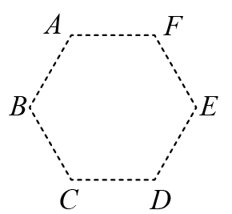

# Physics - 题目 640

**ID**: 57a05ce6e70546f890323824748494b2
**年级**: Grade 11
**难度**: Medium
**题型**: Multiple-select

## 题目
如图，在匀强电场中，A、B、C、D、E、F位于边长为L＝2 cm的正六边形的顶点上，匀强电场的方向平行于正六边形所在的平面．已知A、B、D、E的电势分别为－2 V、 0 V、 6 V、 4 V．则下列说法正确的是（      ）​​​​​​​‌

## 解答

1. 连接AD、BF、CE，如图所示：
2. 
3. 由图可知AD与BF、CE都垂直，电场强度方向由D指向A，由正六边形对称性可知F与B的电势相等，C与E的电势相等，F点的电势为0V，C点的电势为4V，则A、F间的电势差为 $U{{}_{AF}}=φ{{}_{A}}-φ{{}_{F}}=-2-0=-2{\rm{V}}{\rm ，C}$ 、F间的电势差为 $U{{}_{CF}}=φ{{}_{C}}-φ{{}_{F}}=4-0=4{\rm{V}}$ ，由几何关系得 $d{{}_{OA}}=L\sin 30{^{\circ }}$ ， $U{{}_{OA}}=U{{}_{FA}}=-U{{}_{AF}}=2{\rm{V}}$ ，则电场强度的大小为 $E=\frac {U{{}_{OA}}}{d{{}_{OA}}}=\frac {2}{2\times 10{^{-2}}\times \frac {1}{2}}=200{\rm{V}}{\rm{/}}{\rm{m}}{\rm ，AB}$ 错误，CD正确，选CD.

## 知识点

**中文**:
  - 电势差与电场强度的关系

**English**:
  - Relationship between Potential Difference and Field Strength

---
