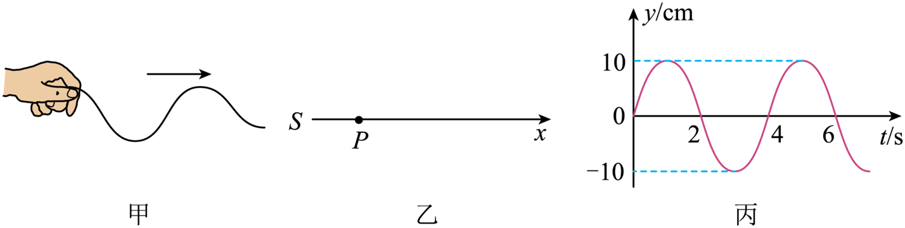

# Physics - 题目 2676

**ID**: 5d2eee0a4db7478d946faaf08cad69cf
**年级**: Grade 11
**难度**: Medium
**题型**: Multiple-select

## 题目
如图甲，某同学取一根柔软的长细绳，用手握住绳子左端连续上下抖动，形成一列向右传播的简谐波，以长绳左端点 $\mathrm{S}$ 为原点建立水平向右的 $x$ 轴，如图乙。​​​​​​​‌ $t=0$ 时绳的左端 $\mathrm{S}$ 点开始上下振动，振动图像如图丙所示。 $t={{6}}{\rm{s}}$ 时停止抖动长绳，在这段时间内绳上 $x={{2}}{\rm{m}}$ 处的质点 $P$ 运动的路程为40cm。关于这列绳波，下列说法正确的是（      ）

## 解答

1. 由图丙可知，  $\mathrm{S}$ 点的振动周期 $T$ 为 $4{\rm{s}}$ ，振幅 $\mathrm{A}$ 为 $10{\rm{c}}{\rm{m}}$ ， $t={{6}}{\rm{s}}$ 内质点 $P$ 运动的路程为 $40{\rm{c}}{\rm{m}}{\rm{=}}{{4}}A$ ，质点 $P$ 只振动了一个周期，波从 $\mathrm{S}$ 点传到质点 $P$ 的时间 $Δt=6{\rm{s}}-4{\rm{s}}{\rm{=}}{{2}}{\rm{s}}{\rm{=}}\frac {1}{2}T$ ， $2{\rm{m}}{\rm{=}}v\cdot \frac {T}{2}{\rm{=}}\frac {1}{2}λ$ ， $λ=4{\rm{m}}{\rm ，A}$ 正确； $t={{6}}{\rm{s}}$ 时，波刚传到 $x={{6}}{\rm{m}}$ 处质点，再过 $1{\rm{s}}$ 即 $\frac {1}{4}T$ ， $x={{6}}{\rm{m}}$ 处质点运动到最大位移处，质点的动能最小，B错误；该波波速 $v=\frac {λ}{T}=\frac {4{\rm{m}}}{4{\rm{s}}}=1{\rm{m}}{\rm{/}}{\rm{s}}$ ，由图丙可知， $\mathrm{S}$ 点 $t=3{\rm{s}}$ 时在波谷，该波谷传到 $x={{5}}{\rm{m}}$ 处所需时间 $Δt{{}_{1}}=\frac {5{\rm{m}}}{1{\rm{m}}{\rm{/}}{\rm{s}}}=5{\rm{s}}$ ， $t={{8}}{\rm{s}}$ 时， $x={{5}}{\rm{m}}$ 处质点处于波谷位置，C正确；波传到 $x={{3}}{\rm{m}}$ 处所需时间 $Δt{{}_{2}}=\frac {3{\rm{m}}}{1{\rm{m}}{\rm{/}}{\rm{s}}}=3{\rm{s}}$ ，因 $t={{6}}{\rm{s}}$ 时停止，由于 $6+3{\rm{s}}=9{\rm{s}}<10{\rm{s}}$ ， $t={{1}}{{0}}{\rm{s}}$ 时 $x={{3}}{\rm{m}}$ 处的质点运动的时间为 $6{\rm{s}}$ ， $x={{3}}{\rm{m}}$ 处质点运动的总路程为 $s=6A=6\times 10{\rm{c}}{\rm{m}}={{6}}{{0}}{\rm{c}}{\rm{m}}{\rm ，D}$ 错误。

## 知识点

**中文**:
  - 振幅、周期、频率、相位和波长及其计算
  - 简谐运动的函数与图像

**English**:
  - Calculation of Amplitude, Period, Frequency, Phase, and Wavelength
  - Functions and Graphs of SHM

---
