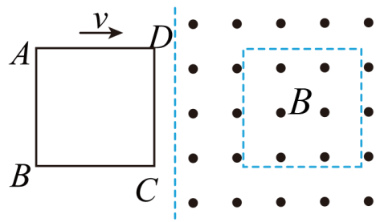

# Physics - 题目 1705

**ID**: 7a9bb981522b4860be21c063fcdea257
**年级**: Grade 11
**难度**: Medium
**题型**: Multiple-select

## 题目
如图所示，单匝线圈ABCD在外力作用下以速度v向右匀速进入匀强磁场，此过程中线圈中电流为I_{1}，，线圈发热功率为P_{1}，产生的热量为Q_{1}，流过线圈导线横截面的电荷量为q_{1}。​​​​​​​‌若使该线圈以速度2v向右匀速进入该匀强磁场，此过程对应的上述物理量分别为I_{2}、P_{2}、Q_{2}和q_{2}。下列关系式正确的是（      ）

## 解答

1. 根据 $I{{}_{1}}=\frac {E{{}_{1}}}{R}=\frac {BLv}{R}$ ， $I{{}_{2}}=\frac {E{{}_{2}}}{R}=\frac {BL\cdot 2v}{R}$ ，可得 $\frac {I{{}_{1}}}{I{{}_{2}}}=\frac {1}{2}$ ，故A正确；根据P=I^{2}R，可得 $\frac {P{{}_{1}}}{P{{}_{2}}}=\frac {I{{}_{1}^{2}}}{I{{}_{2}^{2}}}=\frac {1}{4}$ ，故B错误；线圈进入该匀强磁场的时间为 $t=\frac {L}{v}$ ，则有 $\frac {t{{}_{1}}}{t{{}_{2}}}=\frac {2v}{v}=\frac {2}{1}$ ，根据Q=I^{2}Rt，可得 $\frac {Q{{}_{1}}}{Q{{}_{2}}}=\frac {I{{}_{1}^{2}}}{I{{}_{2}^{2}}}\cdot \frac {t{{}_{1}}}{t{{}_{2}}}=\frac {1}{4}\times \frac {2}{1}=\frac {1}{2}$ ，故C错误；根据q=It，可得 $\frac {q{{}_{1}}}{q{{}_{2}}}=\frac {I{{}_{1}}}{I{{}_{2}}}\cdot \frac {t{{}_{1}}}{t{{}_{2}}}=\frac {1}{2}\times \frac {2}{1}=1$ ，故D正确。

## 知识点

**中文**:
  - 电磁感应现象中的功能问题

**English**:
  - Work-Energy Problems in EM Induction

---
