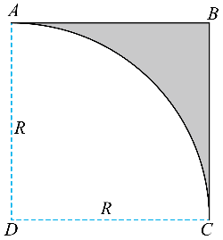

# Physics - 题目 1057

**ID**: 7c759e3af4c8493e8952f9c04575bee8
**年级**: Grade 11
**难度**: Medium
**题型**: Multiple-select

## 题目
如图所示，图中阴影部分ABC为一透明材料做成的柱形光学元件的横截面，该种材料对红光的折射率n=2，AC为一半径为R的四分之一圆弧，D为圆弧面圆心，ABCD构成正方形。​​​​​​​‌在D处有一红色点光源，在纸面内照射弧面AC，若只考虑首次从圆弧AC直接射向AB、BC的光线，已知光在真空中速度为c，则以下说法正确的是（      ）

## 解答

1. A．由 $v=\frac {c}{n}$ 可知，红光在该材料中的传播速度为 $\frac {c}{2}$ ，A正确；
2. B．由题意可知，沿DB方向到达AB面上的光在材料中的传播距离最大，时间最长，做出如图所示光路图，有几何关系可知光从光源到AC面的传播距离为R，材料中的传播距离为
3. $s=(\sqrt {2}-1)R$
4. 在材料中的传播时间为
5. $t{{}_{1}}=\frac {s}{v}=\frac {(\sqrt {2}-1)R}{\frac {c}{2}}=\frac {2(\sqrt {2}-1)R}{c}$
6. 光在空气中传播的时间为
7. $t{{}_{1}}=\frac {R}{c}$
8. 点光源发出的光射到AB面上的最长时间为
9. $t=t{{}_{1}}+t{{}_{2}}=\frac {(2\sqrt {2}-1)R}{c}$
10. B错误；
11. 
12. C．根据
13. ${\sin}C=\frac {1}{n}$
14. 可知临界角为
15. C=30°
16. 如图所示，若沿DE方向射到AB面上的光线刚好发生全反射，则 $\angle ADF=30{}^\circ $ ，同理沿DG方向射到BC面上的光线刚好发生全反射，则 $\angle CDH=30{}^\circ $ ，故
17. $\overset ⌢{{FH}}=\frac {1}{6}πR$
18. 即照射在AC边上的入射光，有弧长为 $\frac {1}{6}πR$ 区域的光不能从AB、BC边直接射出，选项C正确；
19. D．将点光源换成紫光，因紫光的折射率比红光的大，根据
20. ${\sin}C=\frac {1}{n}$
21. 知紫光的临界角比红光的小，所以AB边上刚好发生全反射的入射点将左移，AB边上有光射出的长度减小，D错误。
22. 故选AC。

## 知识点

**中文**:
  - 全反射与折射的综合应用
  - 全反射原理及其应用

**English**:
  - Comprehensive Application of Total Reflection and Refraction
  - Principle and Applications of Total Internal Reflection

---
