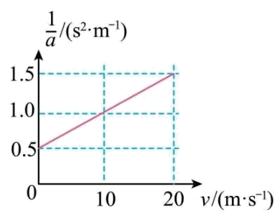

# Physics - 题目 1648

**ID**: 8cdfcd9dec58412887a172cef4bcd270
**年级**: Grade 11
**难度**: Medium
**题型**: Multiple-select

## 题目
2024是我国新能源汽车销量持续爆发的一年，火爆的销量离不开车企的严谨务实的前期测试。​​​​​​​‌某国产新能源汽车上市之前在一条直线跑道上进行“单踏板模式”性能测试，测试过程分为三个阶段。阶段I：驾驶员踩下电门至某一位置，汽车由静止启动，其加速度的倒数 $\frac {1}{a}$ 与速度 $v$ 的关系如图所示，当汽车加速至 $v{{}_{1}}=20{\rm{m}}/{\rm{s}}$ 时进入阶段II。阶段II：驾驶员通过适当调节电门，使汽车做匀加速直线运动，以加速度 $a^{′}=2\,{\rm{m}}/{\rm{s}}{^{2}}$ 加速至 $v{{}_{2}}=30{\rm{m}}/{\rm{s}}$ 时进入阶段III。阶段III：驾驶员松开电门，汽车的能量回收，制动系统启动，汽车开始减速直至停下，该减速过程中汽车的加速度 $a{^{^{′′}}}$ 与速度 $v$ 满足关系式 $a{^{^{′′}}}=-kv$ （其中 $k=1{\rm{s}}{^{-1}}$ ）。则（      ）

## 解答

1. $\frac {1}{a}-v$ 图像与 $v$ 轴围成的面积等于时间， $\left ({0.5+1.5}\right )\times 20\div 2{\rm{s}}=20{\rm{s}}$ 故A正确；由位移计算公式 $v{{}_{2}}{^{2}}-v{^{2}}{{}_{{{1}}}}=2a\prime x{^{2}}$ ，可知 $x{{}_{2}}=\frac {30{^{2}}-20{^{2}}}{2\times 2}{\rm{m}}=125{\rm{m}}$ ，故B正确；由时间公式 $v{{}_{2}}=v{{}_{1}}+a\prime t{{}_{2}}$ ，可知 $t{{}_{2}}=\frac {30-20}{2}{\rm{s}}=5{\rm{s}}$ ，故C错误；由 $a{^{^{′′}}}=-kv$ ，可知 $\frac {Δv}{Δt}=-k\frac {Δx}{Δt}$ ，则 $Δv=-kΔx$ ，代入数据 $0-30{\rm{m}}{\rm{/}}{\rm{s}}{\rm{=}}{{-}}{{1}}{\rm{s}}{^{-1}}{\rm{Δ}}x$ ， $Δx=30{\rm{m}}$ ，故D正确。

## 知识点

**中文**:
  - 非常规图像问题

**English**:
  - Non-standard Graph Problems

---
