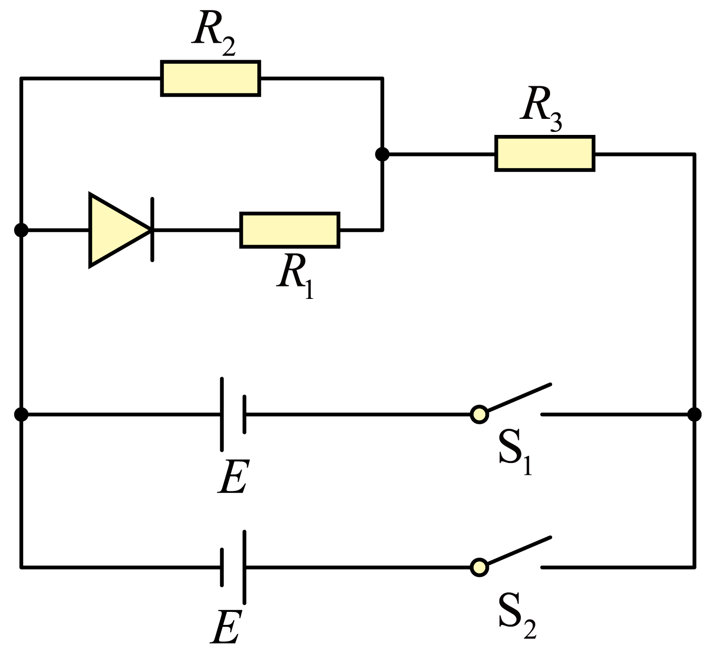

# Physics - 题目 891

**ID**: 8d85e18ad0604aeb81254b2a3ebd4109
**年级**: Grade 11
**难度**: Medium
**题型**: Multiple-select

## 题目
如图所示的电路中，定值电阻 $R{{}_{1}}=6R{{}_{3}}$ ， $R{{}_{2}}=3R{{}_{3}}$ ，两个电源电动势相同，内阻均不计，二极管为理想二极管。​​​​​​​‌仅闭合开关 ${\rm{S}}{{}_{1}}$ 时，电路中的总功率为P。下列说法正确的是（      ）

## 解答

1. 仅闭合 ${\rm{S}}{{}_{1}}$ 时，根据二极管的单向导电性，可知 $R{{}_{2}}$ 与 $R{{}_{1}}$ 并联，再与 $R{{}_{3}}$ 串联，设此时通过 $R{{}_{3}}$ 的电流为 $I$ ，则有 $I=\frac {E}{R{{}_{并}}+R{{}_{3}}}=\frac {E}{\frac {6R{{}_{3}}\cdot 3R{{}_{3}}}{6R{{}_{3}}+3R{{}_{3}}}+R{{}_{3}}}=\frac {E}{3R{{}_{3}}}$ ，电路中的总功率为 $P=I{^{2}}\left ({R{{}_{3}}+R{{}_{并}}}\right )=3I{^{2}}R{{}_{3}}$ ，根据串、并联电路中电流与电阻的关系，可知流经 $R{{}_{1}}$ 的电流为 $\frac {1}{3}I$ ，流经 $R{{}_{2}}$ 的电流为 $\frac {2}{3}I$ ，则 $R{{}_{1}}$ 和 $R{{}_{3}}$ 消耗的功率分别为 $P{{}_{1}}={\left({\frac {1}{3}I}\right)^{2}}·6R{{}_{3}}=\frac {2}{9}P$ ， $P{{}_{3}}=I{^{2}}·R{{}_{3}}=\frac {1}{3}P{\rm ，A}$ 错误，B正确；仅闭合 ${\rm{S}}{{}_{2}}$ 时，根据二极管的单向导电性，可知 $R{{}_{2}}$ 与 $R{{}_{3}}$ 串联，设此时通过 $R{{}_{3}}$ 的电流为 $I^{′}$ ，则 $I^{′}=\frac {E}{3R{{}_{3}}+R{{}_{3}}}=\frac {E}{4R{{}_{3}}}=\frac {3}{4}I$ ，则 $R{{}_{2}}$ 消耗的功率 $P^{′}{{{}_{2}}}=I^{′}{{^{2}}}·3R{{}_{3}}=\frac {9}{16}P$ ，电路中的总功率 $P{{}_{总}}=I^{′}{{^{2}}}·4R{{}_{3}}=\frac {3}{4}P{\rm ，C}$ 正确，D错误。

## 知识点

**中文**:
  - 闭合电路输出功率与效率

**English**:
  - Output Power and Efficiency of Closed Circuits

---
