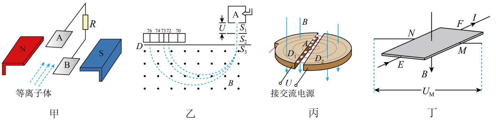

# Physics - 题目 2285

**ID**: 8e0aef415a9840f689a6f381e0d8104e
**年级**: Grade 11
**难度**: Medium
**题型**: Multiple-select

## 题目
下列四幅图分别是等离子体发电机、质谱仪、回旋加速器、霍尔元件的示意图，进入装置的带电粒子重力均不计，下列说法正确的是（      ）​​​​​​​‌

## 解答

1. 根据左手定则可知等离子体中正电荷向B板偏转，负电荷向A板偏转，所以A极板是发电机的负极，B极板是发电机的正极，A错误；粒子打在底片上的位置到狭缝 ${\rm{S}}{{}_{3}}$ 的距离为 $d=2r=\frac {2mv}{Bq}$ ，结合加速电场 $qU=\frac {1}{2}mv{^{2}}$ ，联立可得 $d=\frac {2}{B}\sqrt {\frac {2mU}{q}}$ ，由该式可知d越小，粒子比荷 $\frac {q}{m}$ 越大，B正确；设回旋加速器D形盒的半径为R，粒子获得的最大速度为 $v{{}_{{\rm{m}}}}$ ，根据牛顿第二定律有 $Bqv{{}_{{\rm{m}}}}=\frac {mv{{}_{{\rm{m}}}^{2}}}{R}$ ，解得 $v{{}_{{\rm{m}}}}=\frac {BqR}{m}$ ，由上式可知粒子获得的最大速度与加速电压无关，所以无法通过增大加速电压使带电粒子获得的最大动能增大，C错误；图丁中若导体中的载流子是电子，根据左手定则可知，电子运动到N板，则导体左右两侧的电势 $φ{{}_{N}}<φ{{}_{M}}{\rm ，D}$ 正确。

## 知识点

**中文**:
  - 回旋加速器
  - 霍尔元件
  - 质谱仪
  - 磁流体发电机

**English**:
  - Cyclotron
  - Hall Element
  - Mass Spectrometer
  - MHD Generator

---
