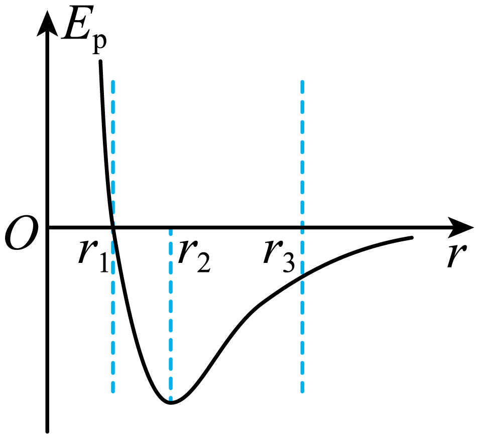

# Physics - 题目 830

**ID**: a58d7ce76e1145eebed791be320f8c98
**年级**: Grade 11
**难度**: Medium
**题型**: Multiple-select

## 题目
分子间存在着分子力，并且分子间存在与其相对距离有关的分子势能。​​​​​​​‌分子势能 $E{{}_{{\rm{p}}}}$ 随分子间距离r变化的图像如图所示，取r趋近于无穷大时 $E{{}_{{\rm{p}}}}$ 为零。通过功能关系可以从此图像中得到有关分子力的信息，若仅考虑两个分子间的作用，下列说法正确的是（      ）

## 解答

1. E_{p}-r图像上各点切线的斜率大小表示分子力大小，由图可知分子间距离由 $r{{}_{3}}$ 减小为 $r{{}_{2}}$ 的过程中，分子力先增大后减小，A正确；在两分子间距离从无穷大减小至平衡距离的过程中，分子力表现为引力且一直做正功，分子势能一直减小，在平衡距离时分子势能最小，所以由图可知分子间距离为 $r{{}_{2}}$ 时，引力和斥力平衡，假设将两个分子从 $r=r{{}_{2}}$ 处释放，它们将保持静止，B正确，C错误；由图可知，r_{1}处分子势能为零，且分子间作用力表现为斥力，而r_{3}处分子势能小于零，所以将两个分子从 $r=r{{}_{1}}$ 处释放，分子间距离将增大，且根据功能关系可知，分子间距离可以大于r_{3}，D错误。

## 知识点

**中文**:
  - 分子势能随分子间距离变化的图像问题

**English**:
  - Graph of Molecular Potential Energy vs Distance

---
