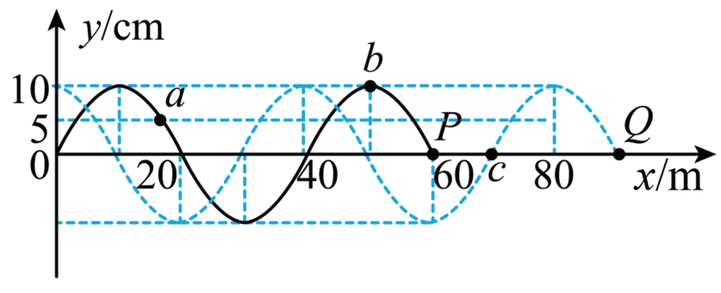

# Physics - 题目 1977

**ID**: bd23e973961c4aa2a8cc46616297f1b8
**年级**: Grade 11
**难度**: Medium
**题型**: Multiple-select

## 题目
一列简谐横波沿x轴正方向传播，t时刻波形图如图中的实线所示，此时波刚好传到P点，t＋0.​​​​​​​‌6s时刻的波形如图中的虚线所示，a、b、c、P、Q是介质中的质点，则（      ）

## 解答

1. 由图可知，波的波长为40m；两列波相距： $0.6{\rm{s}}=(n+\frac {3}{4})T$ ，周期： $T=\frac {2.4}{4n+3}$ ；波速： $v=\frac {λ}{T}={\frac {40}{\frac {2.4}{4n+3}}}{\rm{m}}/{\rm{s}}=\frac {50}{3\left ({4n+3}\right )}{\rm{m}}/{\rm{s}}$ ，当v=150m/s时，无正整数符合题意，A错误；质点a在平衡位置上下振动，振动的最少时间为 $ \frac {3}{4}T$ ，路程最小为30cm，B错误；质点c的路程为60cm说明c振动了1.5个周期，则可有： $\frac {10}{v}+1.5T=0.6$ ，即： $\frac {3}{5\left ({4n+3}\right )}+\frac {3.6}{4n+3}=0.6$ ，解得n=1时满足条件，C正确；在t时刻，因波沿x轴正方向传播，所以此时质点P是向上振动的，经0.5秒后，P是正在向下振动（负位移），是经过平衡位置后向下运动0.1秒；而质点b是正在向上振动的（负位移），是到达最低点后向上运动0.1秒，因为0.2秒等于 $\frac {T}{4}$ ，可见此时两个质点的位移是相同的，D正确。

## 知识点

**中文**:
  - 波的多解问题

**English**:
  - Multi-solution Problems in Waves

---
