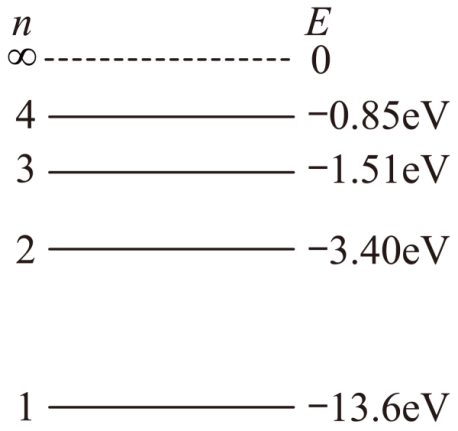

# Physics - 题目 815

**ID**: c184195ab1c348dcacdacc830a9cb56f
**年级**: Grade 11
**难度**: Medium
**题型**: Multiple-select

## 题目
氢原子能级图如图所示，氢原子从 $n\geqslant 3$ 的各个能级直接跃迁至 $n=2$ 能级时，辐射光的谱线称为巴尔末线系。​​​​​​​‌关于巴尔末线系，下列说法正确的有（      ）

## 解答

1. A．波长最长的谱线对应的光子能量是从 $n=3$ 能级跃迁到 $n=2$ 能级释放出的光子，其能量为 ${\rm \varepsilon =E{{}_{3}}-E{{}_{2}}=-1.51-\left ({-3.4}\right ){\rm{e}}{\rm{V}}=1.89{\rm{e}}{\rm{V}}}$ ，A正确；
2. B．由于氢原子从 $n\geqslant 3$ 的各个能级直接跃迁至 $n=2$ 能级时，辐射光的谱线称为巴尔末线系，则大量处于 $n=4$ 能级的氢原子向基态跃迁过程，只有 $n=4\to n=2$ 和 $n=3\to n=2$ 两种跃迁辐射出的两种光子的谱线符合巴尔末线系，B错误；
3. C．氢原子从 $n=3$ 能级跃迁至 $n=2$ 能级时，其能量为 ${\rm 1.89{\rm{e}}{\rm{V}}}$ ，小于 ${\rm 2.55{\rm{e}}{\rm{V}}}$ ，辐射出的光子不能使逸出功为 ${\rm 2.25{\rm{e}}{\rm{V}}}$ 的金属发生光电效应，C正确；
4. D．若氢原子从 $n=4$ 能级跃迁至 $n=2$ 能级时辐射出的光子能量为 ${\rm \varepsilon ^{′}=E{{}_{4}}-E{{}_{2}}=-0.85-\left ({-3.4}\right ){\rm{e}}{\rm{V}}=2.55{\rm{e}}{\rm{V}}}$ ，使某金属发生光电效应，根据 ${\rm E{{}_{{\rm{k}}{\rm{m}}}}=\varepsilon ^{′}-W{{}_{0}}}$ ，可知，由于 ${\rm W{{}_{0}}}$ 大于零，则光电子的最大初动能小于 ${\rm 2.55{\rm{e}}{\rm{V}}}$ ，D错误。选AC。

## 知识点

**中文**:
  - 氢原子的能级结构、能级公式和跃迁问题

**English**:
  - Hydrogen Energy Levels, Formulas, and Transitions

---
