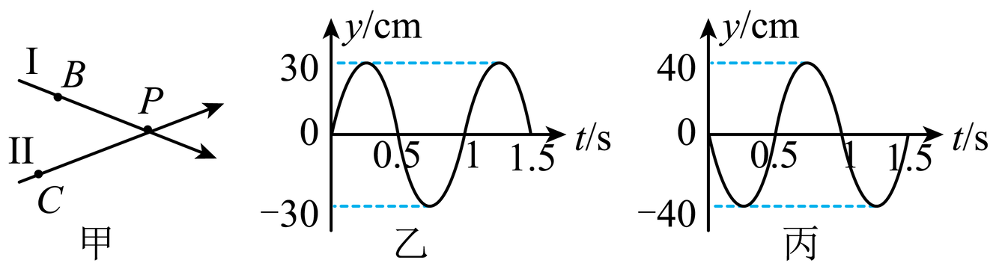

# Physics - 题目 2183

**ID**: cb8605dae3fe4cf99a93d1f0a5134765
**年级**: Grade 11
**难度**: Medium
**题型**: Multiple-select

## 题目
如图甲所示，B、C和P是同一水平面内的三个点，沿竖直方向振动的横波I在介质中沿BP方向传播，P与B相距 ${{4}}{{0}}{\rm{c}}{\rm{m}}$ ，B点的振动图像如图乙所示；沿竖直方向振动的横波Ⅱ在同一介质中沿CP方向传播，P与C相距 ${{5}}{{0}}{\rm{c}}{\rm{m}}$ ，C点的振动图像如图丙所示。​​​​​​​‌在 $t=0$ 时刻，两列波同时分别经过B、C两点，两列波的波速都为 ${{2}}{{0}}{\rm{c}}{\rm{m}}{\rm{/}}{\rm{s}}$ ，两列波在P点相遇，则以下说法正确的是（      ）

## 解答

1. A．由图可知，两列波的周期均为T=1s，由波长公式 $λ=vT=20\times 10{^{-2}}\times 1{\rm{m}}=0.2{\rm{m}}={{2}}{{0}}{\rm{c}}{\rm{m}}$ ，所以A正确；
2. B．由于两列波到P点的路程差为 $PC-PB=50{\rm{c}}{\rm{m}}-40{\rm{c}}{\rm{m}}=10{\rm{c}}{\rm{m}}=0.5λ$ ，而t=0时刻两列波的振动方向相反，则P点是振动加强的点，振幅等于两波振幅之和，所以P点为加强点其振幅为70cm，则B正确；
3. C．波从C传到P的时间为 $t=\frac {PC}{v}=\frac {0.5}{0.2}{\rm{s}}=2.5{\rm{s}}$ ，波从B传到P的时间为 $t^{′}=\frac {PB}{v}=\frac {0.4}{0.2}{\rm{s}}=2{\rm{s}}$ ，在t=2.5s时，两波叠加，质点P经过平衡位置向下运动，在t=4.5s时，质点经过了两个周期，质点经过平衡位置向下运动，所以C正确；
4. D．依据发生明显衍射条件，由于40cm> $λ={\rm 20cm}$ ，则波遇到40cm的障碍物将不能发生明显衍射现象，所以D错误；选ABC。

## 知识点

**中文**:
  - 波的干涉的应用

**English**:
  - Applications of Wave Interference

---
