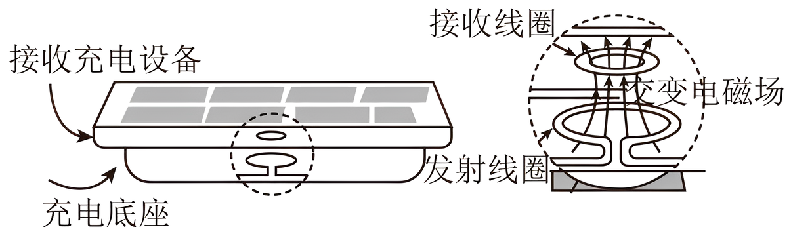

# Physics - 题目 2460

**ID**: db07f9f157c5474592a94ae3f878b983
**年级**: Grade 11
**难度**: Medium
**题型**: Multiple-select

## 题目
某种手机的无线充电原理如图所示。​​​​​​​‌无线充电器中的基座线圈 $u=220\sqrt {2}{\rm{s}}{\rm{i}}{\rm{n}}\left ({100{\rm{π}}t}\right )\left ({{\rm{V}}}\right )$ 的交变电源相连产生变化的磁场，手机中的接收线圈便能感应出电流给手机电池充电。已知接收线圈的两端电压为5V，假设发射线圈产生磁场全部穿过接收线圈，下列说法正确的是（      ）

## 解答

1. A．无线充电工作原理是电磁感应原理，与变压器工作原理相同，选项A正确；
2. B．接收线圈中电流的频率等于交流电源的频率 $f=\frac{\omega }{2\pi }=50\text{{\rm Hz}}$ ，选项B错误；
3. C．1s时间为50个周期，一个周期内电流方向变化2次，则1s内接收线圈电流方向变化100次，选项C正确；
4. D．发射线圈与接收线圈的匝数之比 $n{{}_{1}}:n{{}_{2}}=220:5=44:1$ ，选项D错误。选AC。

## 知识点

**中文**:
  - 交变电流的周期、频率

**English**:
  - Period and Frequency of AC

---
