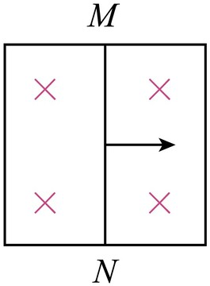

# Physics - 题目 2684

**ID**: f483925610474b1c87d2a36d9afce957
**年级**: Grade 11
**难度**: Medium
**题型**: Multiple-select

## 题目
如图所示，边长1m的正方形光滑固定金属导轨水平放置，处在竖直向下、磁感应强度大小为0.5T的匀强磁场中。​​​​​​​‌长度为1m的金属棒MN垂直导轨放置，且与导轨接触良好，导轨和金属棒单位长度的电阻均为2Ω。当MN以4m/s的速度向右经过导轨中点时，下列说法正确的是（      ）

## 解答

1. A．金属棒切割磁感线，金属棒相对于一个电源，根据右手定则可知，金属棒中电流由N到M，M相对于等效电源的正极，可知，M点电势比N点电势高，A正确；
2. B．在导轨中点位置，支路并联两部分电阻相等，回路总电阻 $R=2Ω+\frac {2\times \left ({1+0.5+0.5}\right )}{2}Ω=4Ω$ ，感应电动势 $E=BLv=2{\rm{V}}$ ，则棒中电流大小为 $I=\frac {E}{R}=0.5{\rm{A}}{\rm ，B}$ 错误；
3. C．结合上述，根据闭合电路欧姆定律，MN两点间电压 $U=E-IR{{}_{内}}=1{\rm{V}}{\rm ，C}$ 正确；
4. D．导轨的热功率 $P=EI-I{^{2}}R{{}_{内}}=0.5{\rm{W}}{\rm ，D}$ 错误。选AC。

## 知识点

**中文**:
  - 导体切割磁感线产生感应电动势（电流）的分析与计算

**English**:
  - Analysis and Calculation of Cutting Magnetic Field Lines

---
